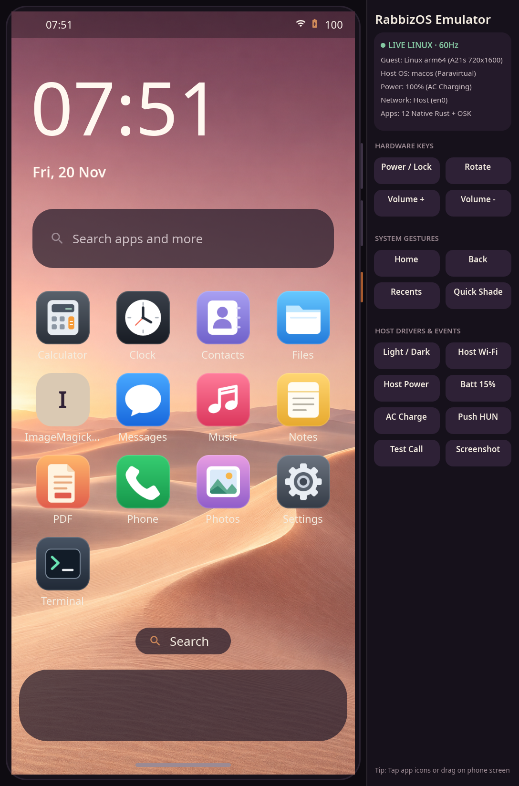
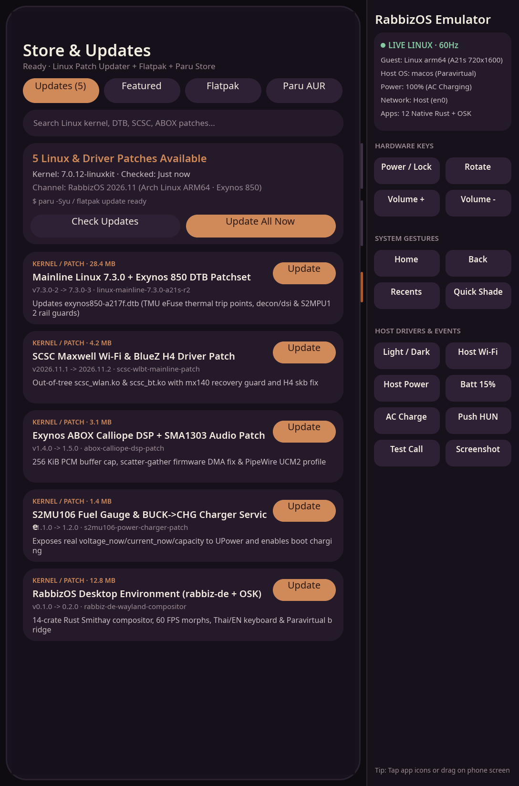
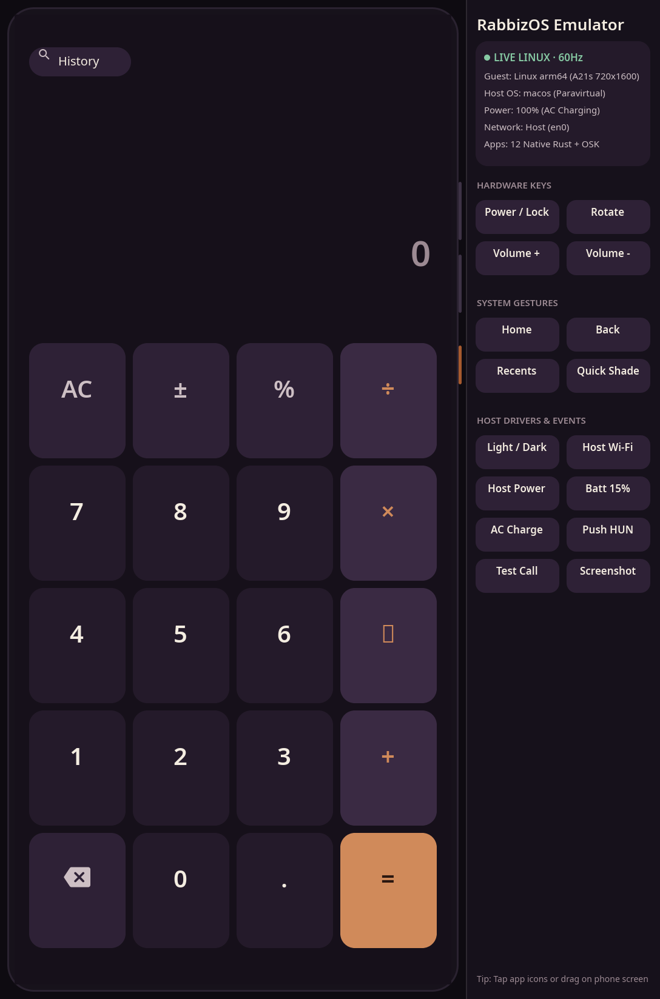
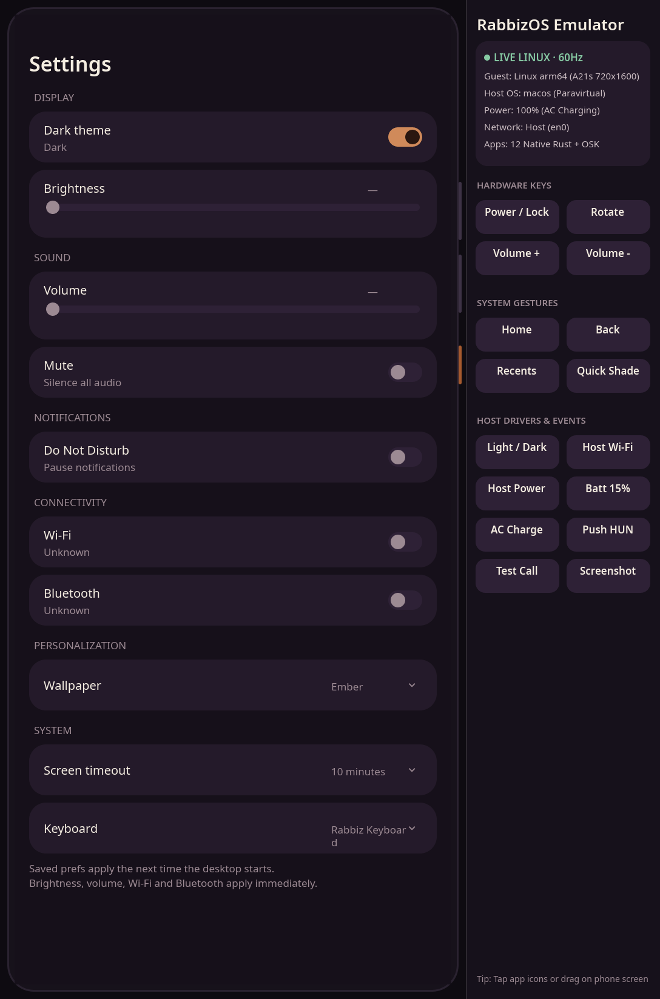

<p align="center"></p>

# RabbizOS

> ## 🌱 This is only the very beginning
>
> RabbizOS is at its earliest stage. Expect rough edges, missing pieces, things that
> break, and decisions that will change. It boots and runs on real phone hardware today,
> and includes a full **60 FPS ARM64 Linux Emulator & Multi-Language SDK** so anyone can
> build and test apps on macOS, Linux, or Windows without a physical phone. It is **not**
> a daily-driver system yet. That is exactly why we are opening the project to contributors
> now — come and shape it from the start. See [CONTRIBUTING.md](CONTRIBUTING.md).

**An Arch Linux ARM–based mobile Linux system, native Rust Wayland Desktop Environment (`rabbiz-de`), Application Suite (`rabbiz-apps`), and Developer SDK & Emulator (`rabbiz-sdk`), by Devded.**

RabbizOS brings **bare-metal Native Mainline Linux (`7.3.0`)** to phones and tablets with zero Android runtime, zero Termux, and zero proot. It features its own 14-crate Rust Wayland compositor (`rabbiz-de`), 12 native Rust mobile applications (`rabbiz-apps`), an EN/TH Wayland on-screen keyboard (`rabbiz-osk`), a multi-language Application SDK (`rabbiz-sdk`), a live 60 FPS ARM64 Linux Emulator (`rabbiz-emu-viewer`), and a native macOS screen-sharing companion (**Rabbiz Mirror**).

- **Primary Device (Phase 1):** Samsung Galaxy A21s (`SM-A217F`, Exynos 850 / `S5E3830`, 3 GB RAM) — **Booting & Working on Bare Metal**
- **Secondary Device (Phase 2):** Xiaomi Pad 7 Pro (`muyu`, Snapdragon 8s Gen 3 / `SM8635`) — **Planned**
- **Desktop Emulator & SDK (`rabbiz-emu`):** macOS (Apple Silicon / Intel), Linux, Windows — **Working (60 FPS Paravirtual ARM64 Linux)**

> ## ⚠️ Disclaimer — use entirely at your own risk
>
> RabbizOS is experimental software for real phones and tablets. **Everything in this repository —
> code, scripts, documentation, images and instructions — is provided "as is", without warranty of any
> kind, and you use it entirely at your own risk.** By flashing, installing, running or following any
> part of it you accept that:
>
> - the device can be **bricked**, data on it **lost**, and hardware (battery, display, storage) damaged;
> - unlocking a bootloader or installing another system can **void your warranty** and may disable
>   features of the original system (banking apps, DRM-protected content, updates);
> - you are responsible for **backing up** your device and for knowing how to **restore** it before you
>   change anything;
> - parts of this project are written or assisted by AI and have been tested on only a few devices, so
>   instructions and code can be wrong or out of date;
> - the authors and contributors are **not liable** for any damage, data loss or other consequence, and
>   the project is independent: it is not affiliated with or endorsed by Samsung, Xiaomi, Valve, Google or any
>   other hardware or software vendor, whose names belong to their owners.
>
> If you are not comfortable with these risks, do not use it. See also the warranty and liability terms
> of the [Apache-2.0 license](LICENSE) (original code) and the licenses of the components listed in
> [drivers/LICENSING.md](socs/exynos850/drivers/LICENSING.md).

<p align="center"></p>

[Contributing](CONTRIBUTING.md) · [SDK Guide](docs/SDK.md) · [Emulator Guide](docs/EMULATOR.md) · [Architecture](docs/ARCHITECTURE.md) · [Build Guide](docs/BUILD.md) · [Add a Device](docs/NEW-DEVICE.md) · [Lanes](docs/LANES.md) · [Brand & Mascot](docs/BRAND.md) · [Roadmap](ROADMAP.md)

## Support the project

RabbizOS is built in spare time on real hardware. If it is useful to you, you can support it:

<p align="center">
  <a href="https://buymeacoffee.com/silkyland"></a>
  <a href="https://www.paypal.com/paypalme/nuntates"></a>
</p>

Donations are optional and do not buy priority on issues or pull requests.

---

## System Highlights

### 1. Native Rust Desktop Environment (`tools/rabbiz-de/`)
A 14-crate touch-first Wayland compositor and shell built on Smithay, `tiny-skia`, and `cosmic-text` with a strict one-way dependency graph (`python3 tools/rabbiz-de/scripts/check_seams.py`):
- **Frozen Core Contract (`de-api` v1.1):** Geometries (`Point`, `Rect`, `Size`, `Insets`), premultiplied RGBA8 `Pixels`, `DisplayArea` z-order bands, and IPC contracts.
- **Plum / Copper / Warm Cream Design System (`de-design`):** Shared tokens (`tokens::LIGHT`, `tokens::DARK`), spring physics (`Spring`, `PullModel`, `GestureTracker`), and typography scales.
- **Full Mobile Shell (`de-ui` + `de-core`):** `~/Desktop` icon grid & 5-slot dock, spring-animated App Drawer, Search, Recents carousel with live surface thumbnails, One UI–style Quick Settings & Notification Shade, Keyguard (PIN/swipe lock screen),Heads-Up Notifications (HUN), and 60 FPS launch/close morph transitions.
- **Dual Backend (`--backend=drm|virtual`):** Runs directly on KMS/DRM + `libinput` + `libseat` on phone hardware, or headless/virtual over TCP (`--emu-listen`, `--ctl-listen`) inside the RabbizOS Emulator.

### 2. First-Party Native Rust Apps (`tools/rabbiz-apps/` & `tools/rabbiz-osk/`)
All 13 built-in apps plus the session keyboard are pure Rust Wayland clients sharing `rabbiz-app-kit` (`wl_shm` + `xdg_toplevel` + `zwp_text_input_v3` + built-in MCP server):

| App | Crate / Binary | Description |
|---|---|---|
| **Calculator** | `rabbiz-calculator` | Expression engine, history sheet, scientific/basic keypad |
| **Clock** | `rabbiz-clock` | World clock, alarms, stopwatch, countdown timer |
| **Contacts** | `rabbiz-contacts` | Address book, search, favorites, vCard persistence |
| **Files** | `rabbiz-files` | Touch file manager, breadcrumbs, storage usage, quick filters |
| **Messages** | `rabbiz-sms` | Conversation threads, bubble composer, oFono/demo SMS store |
| **Music** | `rabbiz-music` | Library browser, queue, transport controls, PipeWire playback |
| **Notes** | `rabbiz-notes` | Markdown/plain-text notes, tag filters, instant autosave |
| **PDF Reader** | `rabbiz-pdf` | Document viewer, page navigation, zoom, table of contents |
| **Phone** | `rabbiz-dialer` | Keypad, call log, speed dial, in-call screen |
| **Photos** | `rabbiz-photos` | Media grid, lightbox viewer, metadata inspector |
| **Settings** | `rabbiz-settings` | Wi-Fi, Bluetooth, Display, Sound, Battery, Appearance, About |
| **Store & Updates** | `rabbiz-store` | Linux kernel/DTB/driver patch updater + Flatpak, Paru (AUR), and Featured app store |
| **Terminal** | `rabbiz-terminal` | VT100/ANSI terminal emulator with touch shortcut bar |
| **Keyboard (OSK)** | `rabbiz-osk` | `wlr-layer-shell` + `zwp_input_method_v2` keyboard (EN + Thai Kedmanee, long-press alternates) |

### 3. RabbizOS Emulator (`rabbiz-emu`) & Multi-Language SDK (`tools/rabbiz-sdk/`)
Build, debug, and package RabbizOS apps on **macOS, Linux, or Windows** without physical phone hardware:
- **3-Tier Emulation Architecture:**
  - **Tier 1 — Instant Host Simulator (`--sim`):** Run any `rabbiz-app-kit` or `rabbiz-sdk` app directly as a native macOS/Linux/Windows window (`winit` + `softbuffer`) in `< 1 s` with hotkeys (`Cmd+L` Light/Dark, `Cmd+K` OSK inset, `Cmd+R` Rotate, `Cmd+S` Screenshot).
  - **Tier 2 — Live ARM64 Linux Emulator (`rabbiz-emu-viewer`):** Runs the real ARM64 Linux `rabbiz-de --backend=virtual`, `rabbiz-osk`, and all 12 compiled Linux `rabbiz-apps` in the background while bridging **Host OS Paravirtual Drivers** (1:1 Retina `720×1600` 60Hz `RAW_IF_NEWER` display stream, host mouse/trackpad/keyboard input, macOS `pmset` / Linux `power_supply` battery & AC status, and host network status) alongside a 16-button Studio Dock.
  - **Tier 3 — Full OS QEMU VM (`rabbiz emu vm`):** Boots a full Arch Linux ARM64 + Mainline Linux `7.3.0` disk image (`scripts/build_emu_image.sh`) under `qemu-system-aarch64` with `hvf`/`kvm` acceleration.
- **6 Language Templates in SDK v1 (`rabbiz new --template <tpl>`):**
  - **Rust (`rust`):** Native `rabbiz-sdk` (`RabbizApp` trait, widgets, intents, atomic JSON storage, `TestHarness<S>`).
  - **C / C++ (`c`):** Stable C99 ABI (`librabbiz_sdk_c` + [`include/rabbiz_sdk.h`](tools/rabbiz-sdk/include/rabbiz_sdk.h)).
  - **WebAssembly (`wasm`):** Sandboxed `.wasm` bytecode runner (`rabbiz-wasm-runner` + [`wit/rabbiz-app.wit`](tools/rabbiz-sdk/wit/rabbiz-app.wit)) with fuel metering and capability checks.
  - **Flutter / Dart (`flutter`):** `rabbiz-flutter-runner` embedder + Dart FFI package ([`packages/rabbiz_sdk_dart`](tools/rabbiz-sdk/packages/rabbiz_sdk_dart)).
  - **GTK4 (`gtk4`) & Qt6 (`qt6`):** Standard Wayland Desktop Contract templates.
- **`.rbz` Packaging & AI Agent MCP (`rabbiz emu --mcp`):** Deterministic SHA-256 verified `.rbz` bundles (`rabbiz pack/verify/install`) and a 9-tool JSON-RPC 2.0 MCP server so AI coding agents can inspect, tap, swipe, type, and verify UI screenshots autonomously.

<p align="center">
  
  
  
  
</p>
<p align="center"><em>Live 60 FPS ARM64 Linux Emulator (<code>rabbiz-emu-viewer</code>) running <code>rabbiz-de --backend=virtual</code>, <code>rabbiz-store</code>, <code>rabbiz-calculator</code>, and <code>rabbiz-settings</code> driven by Host OS Paravirtual Drivers.</em></p>

---

## Quick Start: Run the Emulator & Build an App (No Phone Required)

### 1. Launch the Live 60 FPS ARM64 Linux Emulator
On macOS, build and open the native **`RabbizOS Emulator.app`** bundle (or run `rabbiz-emu-viewer` directly). It automatically boots the background ARM64 Linux container (`rabbiz-emu-live`) with all 12 native apps and `rabbiz-osk` staged:

```bash
# Option A: Build & launch the macOS app bundle ("dist/RabbizOS Emulator.app")
./scripts/build_mac_emu_app.sh --run

# Option B: Run the cross-platform viewer directly via Cargo
cargo run --release --manifest-path tools/rabbiz-sdk/Cargo.toml -p rabbiz-emu-viewer
```

### 2. Run Any Single App in Tier 1 Instant Host Simulator (`< 1 s`)
```bash
cargo run --manifest-path tools/rabbiz-apps/Cargo.toml -p rabbiz-calculator -- --sim --device=a21s --scale=0.5
```

### 3. Create, Test, Pack & Install a New App with `rabbiz` CLI
```bash
# Build the rabbiz SDK CLI
cargo build --release --manifest-path tools/rabbiz-sdk/Cargo.toml -p rabbiz-cli

# 1. Check your development environment
./tools/rabbiz-sdk/target/release/rabbiz doctor

# 2. Scaffold a new app (choose: rust | c | wasm | flutter | gtk4 | qt6)
./tools/rabbiz-sdk/target/release/rabbiz new /tmp/hello-rabbiz --template rust --id com.devded.hello

# 3. Pack and verify a signed/hashed .rbz bundle
./tools/rabbiz-sdk/target/release/rabbiz pack /tmp/hello-rabbiz --out /tmp/hello-rabbiz.rbz
./tools/rabbiz-sdk/target/release/rabbiz verify /tmp/hello-rabbiz.rbz

# 4. Hot-reload the running emulator's app catalog
./tools/rabbiz-sdk/target/release/rabbiz ctl --tcp 127.0.0.1:5911 reload-apps
```

See **[docs/SDK.md](docs/SDK.md)** and **[docs/EMULATOR.md](docs/EMULATOR.md)** for full tutorials, C ABI / WASM / Flutter guides, and MCP integration.

---

## Hardware Status (`SM-A217F` / Exynos 850)

| Subsystem | Status | Notes |
|---|---|---|
| **Bootloader** | Working | Unlocked S-Boot → `uniLoader` (`a21s_defconfig`) + AVB boot image (`/dev/mmcblk0p18`) |
| **Kernel** | Working | Mainline Linux `7.3.0` (`exynos850-a217f.dts`) |
| **Display & Touch** | Working | `decon` + `dsi` (`syna,td4150-panel`, `720×1600` 60 Hz) + `ovt,td4150` SPI touch + sysfs backlight (`0–255` DCS `0x51`) |
| **GPU (3D / Vulkan)** | Working | Mali-G52 (`panfrost` + Mesa `panvk`, `/dev/dri/renderD128`, CMA leak guard `dumb-destroy.so`) |
| **Desktop Environment** | Working | `rabbiz-de` (native Rust Wayland compositor) + `rabbiz-osk` (EN/TH keyboard) + 12 native Rust `rabbiz-apps` |
| **USB Networking** | Working | USB-C RNDIS (`usb0`, `172.16.42.1/24` via `systemd-networkd`) |
| **Wi-Fi (`wlan0`)** | Working | Out-of-tree SCSC WLBT (`scsc_platform_mif`, `scsc_mx`, `scsc_wlan`) + `NetworkManager` |
| **Bluetooth (`hci0`)** | Working | Ported `scsc_bt.ko` (`h4_recv_skb` BlueZ H4 + `rfkill`) + kernel HID/UHID BLE gamepad stack |
| **Internal Audio (`abox`)** | In Progress | Ported Calliope DSP (`socs/exynos850/drivers/abox/`), `s2mpu12` rails, `sma1303` amp & `aud3004x` codec, 256 KiB buffer cap, PipeWire UCM2 ([Plan](devices/samsung/a21s/docs/a21s-audio-abox-plan.md)) |
| **Battery / Charger / Thermal** | In Progress | `s2mu106` Fuel Gauge & Charger (`upower` live), Exynos 850 `TMU` eFuse-trimmed thermal zones (`80 °C` passive / `95 °C` critical) live ([Finding](devices/samsung/a21s/findings/2026-11-18-flash-thermal-fg-dsi-live.md)) |
| **Cellular Modem (`cpif`)** | Planned | Exynos `cpif` + `pmu-cp` + `oFono` / Voice Call ([Plan](devices/samsung/a21s/docs/a21s-power-battery-modem-plan.md)) |

---

## Repository Layout

```text
.
├── assets/branding/               # RabbizOS wordmark, rabbit R logo, 2D mascot & macOS app icons
├── devices/                       # Per-device kernel configs, DT patches, rules & findings
│   ├── samsung/a21s/              # SM-A217F (Exynos 850): AGENTS.md, device.toml, kernel/, docs/, findings/
│   └── xiaomi/muyu/               # Xiaomi Pad 7 Pro (SM8635): Phase 2 backup & port plan
├── socs/exynos850/drivers/        # Tracked out-of-tree Mainline 7.3 kernel drivers
│   ├── scsc/                      # SCSC Maxwell WLBT (MIF, MX, WLAN, BlueZ H4 BT)
│   └── abox/                      # Exynos 850 ABOX Calliope DSP, SMA1303 amp, AUD3004X, S2MPU12
├── tools/
│   ├── rabbiz-de/                 # 14-crate native Rust Wayland compositor & mobile shell (rabbiz-de)
│   ├── rabbiz-apps/               # 12 first-party native Rust mobile apps + rabbiz-app-kit
│   ├── rabbiz-osk/                # Native Rust Wayland on-screen keyboard (EN/TH, zwp_input_method_v2)
│   ├── rabbiz-sdk/                # Multi-language SDK (Rust/C/WASM/Flutter), .rbz packager, CLI & 60Hz Emulator
│   └── rabbiz-mirror/             # Native macOS screen-mirror companion for physical phones (Swift/AppKit, RFB)
├── rootfs-overlay/                # systemd units, .desktop launchers, hicolor SVG icons, udev & polkit rules
├── shell/                         # QML reference modules & Node.js seam/layout unit tests
├── scripts/                       # Build, test, emulator packaging & device deployment scripts
├── docs/                          # Architecture, SDK, Emulator, Build, Lanes, Findings & Brand guides
├── AGENTS.md                      # OS-wide ground rules & architecture contracts for contributors/agents
├── CONTRIBUTING.md                # Lanes (de, kernel, userland, docs), evidence levels (L0–L3) & workflow
└── ROADMAP.md                     # Milestone status and sequencing
```

> Note: `src/` (upstream `linux`, `uniLoader`, `exynos850-vendor-kernel`, `AIK-Linux`) and `build/` are gitignored.

---

## Building Kernel & Drivers for Real Hardware (`SM-A217F`)

`src/` and `build/` are gitignored, so bootstrap the upstream trees, DTS patches, and kernel defconfig first:

```bash
./scripts/bootstrap_build_env.sh
make -C src/linux O=../../build/linux ARCH=arm64 LLVM=1 -j$(nproc) Image dtbs modules
make -C src/linux O=../../build/linux ARCH=arm64 LLVM=1 M=$PWD/socs/exynos850/drivers/scsc modules
```

See **[docs/BUILD.md](docs/BUILD.md)** for full details (patches applied, `kexec` testing prior to flashing, and `uniLoader` `boot-avb.img` packing).

---

## Mirror a Physical Phone on a Mac (`Rabbiz Mirror`)

In addition to the standalone **RabbizOS Emulator**, a native macOS companion app (`tools/rabbiz-mirror/`) mirrors and controls a physical RabbizOS phone over USB-C or Wi-Fi:

```bash
./scripts/mirror_setup.sh          # sets up mirror service on the physical phone over USB
./scripts/build_mac_app.sh --run   # builds and opens "dist/Rabbiz Mirror.app"
./scripts/verify_mirror.sh         # end-to-end framebuffer check (writes a 720x1600 PNG)
```

Details: **[docs/rabbiz-mirror.md](docs/rabbiz-mirror.md)**.

---

## Running Checks & Tests

```bash
# Run repo-wide shell seam, Rust workspace, and QML/JS checks
./scripts/check.sh

# Verify rabbiz-de 14-crate one-way dependency graph
python3 tools/rabbiz-de/scripts/check_seams.py

# Run all SDK, C ABI, WASM sandbox, Flutter embedder, .rbz packager & Emulator tests
cargo test --manifest-path tools/rabbiz-sdk/Cargo.toml --workspace

# Run all 12 first-party app & rabbiz-app-kit tests
cargo test --manifest-path tools/rabbiz-apps/Cargo.toml --workspace
```

---

## Documentation Index

- **Application SDK Guide (Rust, C99, WASM, Flutter, GTK4, Qt6, `.rbz`):** [docs/SDK.md](docs/SDK.md)
- **Emulator & MCP Server Guide (Tier 1 / Tier 2 / Tier 3):** [docs/EMULATOR.md](docs/EMULATOR.md)
- **SDK & Emulator Master Plan:** [docs/PLAN-SDK-EMULATOR.md](docs/PLAN-SDK-EMULATOR.md)
- **Kernel & Image Build Guide:** [docs/BUILD.md](docs/BUILD.md)
- **System Architecture & ADRs:** [docs/ARCHITECTURE.md](docs/ARCHITECTURE.md)
- **Desktop Shell Design & Contracts:** [docs/DESKTOP-SHELL.md](docs/DESKTOP-SHELL.md)
- **Roadmap & Milestones:** [ROADMAP.md](ROADMAP.md)
- **Contributing, Lanes & Evidence Levels (`L0`–`L3`):** [CONTRIBUTING.md](CONTRIBUTING.md), [docs/LANES.md](docs/LANES.md), [docs/FINDINGS.md](docs/FINDINGS.md)
- **Porting to a New Device:** [docs/NEW-DEVICE.md](docs/NEW-DEVICE.md)
- **Samsung Galaxy A21s Hardware Docs:**
  - [Agent & Hardware Ground Rules](devices/samsung/a21s/AGENTS.md)
  - [Mainline Boot & Recovery](devices/samsung/a21s/docs/a21s-mainline-boot.md), [Boot Recovery](devices/samsung/a21s/docs/a21s-boot-recovery.md)
  - [Native GPU (`Panfrost` / `PanVK`)](devices/samsung/a21s/docs/a21s-native-gpu.md)
  - [SCSC Wi-Fi & Bluetooth Bring-up](devices/samsung/a21s/docs/a21s-wifi-bluetooth.md)
  - [ABOX Calliope Audio Plan](devices/samsung/a21s/docs/a21s-audio-abox-plan.md)
  - [Power, Battery (`s2mu106`), Thermal & Modem Plan](devices/samsung/a21s/docs/a21s-power-battery-modem-plan.md)

---

## Project Identity & Upstream Credits

**RabbizOS** is the project and system name; **Rabbiz** is its rabbit mascot, **RabbizOS Emulator** is the cross-platform developer emulator, and **Rabbiz Mirror** is the native macOS device companion app. Branding assets and usage rules live in [docs/BRAND.md](docs/BRAND.md).

RabbizOS builds on Linux, Arch Linux ARM, uniLoader, Smithay, Mesa, PipeWire, NetworkManager, BlueZ, and other upstream projects. Upstream code, firmware, names, and artwork retain their respective licenses and ownership; the RabbizOS name does not change those terms.
