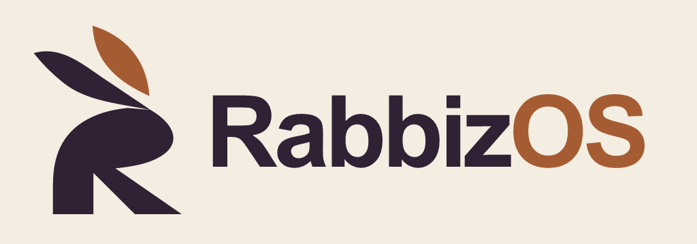

<p align="center"></p>

# RabbizOS

> ## 🌱 This is only the very beginning
>
> RabbizOS is at its earliest stage. Expect rough edges, missing pieces, things that
> break, and decisions that will change. It boots and runs on one phone today; it is
> **not** a daily-driver system yet. That is exactly why we are opening the project to
> contributors now — come and shape it from the start. See [CONTRIBUTING.md](CONTRIBUTING.md).

**An Arch Linux ARM–based mobile Linux system, by Devded.**

RabbizOS brings native Linux to phones and tablets, with its own touch-first shell,
device integration, and desktop companion tools. It runs directly on the hardware,
without Android, Termux, or proot. The project was previously named **Android ARM Linux**.

The current development target is the Samsung Galaxy A21s. This is an experimental
system under active development; hardware support and remaining work are listed below.

> ## ⚠️ Disclaimer — use entirely at your own risk
>
> RabbizOS is experimental software for real phones and tablets. **Everything in this repository —
> code, scripts, documentation, images and instructions — is provided "as is", without warranty of any
> kind, and you use it entirely at your own risk.** By flashing, installing, running or following any
> part of it you accept that:
>
> - the device can be **bricked**, data on it **lost**, and hardware (battery, display, storage) damaged;
> - unlocking a bootloader or installing another system can **void your warranty** and may disable
>   features of the original system (banking apps, DRM-protected content, updates);
> - you are responsible for **backing up** your device and for knowing how to **restore** it before you
>   change anything;
> - parts of this project are written or assisted by AI and have been tested on only a few devices, so
>   instructions and code can be wrong or out of date;
> - the authors and contributors are **not liable** for any damage, data loss or other consequence, and
>   the project is independent: it is not affiliated with or endorsed by Samsung, Xiaomi, Valve, Google or any
>   other hardware or software vendor, whose names belong to their owners.
>
> If you are not comfortable with these risks, do not use it. See also the warranty and liability terms
> of the [Apache-2.0 license](LICENSE) (original code) and the licenses of the components listed in
> [drivers/LICENSING.md](socs/exynos850/drivers/LICENSING.md).

<p align="center"></p>

[Contributing](CONTRIBUTING.md) · [Add a device](docs/NEW-DEVICE.md) · [Lanes](docs/LANES.md) · [Brand & mascot](docs/BRAND.md) · [Desktop shell](docs/DESKTOP-SHELL.md) · [Roadmap](ROADMAP.md)

## Support the project

RabbizOS is built in spare time on real hardware. If it is useful to you, you can support it:

<p align="center">
  <a href="https://buymeacoffee.com/silkyland"></a>
  <a href="https://www.paypal.com/paypalme/nuntates"></a>
</p>

Donations are optional and do not buy priority on issues or pull requests.

The platform combines **Native Mainline Linux (`7.3.0`) + Arch Linux ARM64 + SteamOS (`steam -gamepadui`)** directly on supported phone and tablet hardware (zero Android runtime).

- **Primary Device (Phase 1):** Samsung Galaxy A21s (`SM-A217F`, Exynos 850 / `S5E3830`, 3 GB RAM) — **Booting & Working**
- **Secondary Device (Phase 2):** Xiaomi Pad 7 Pro (`muyu`, `SM8635`) — **Planned**

---

## Hardware Status (`SM-A217F` / Exynos 850)

| Subsystem | Status | Notes |
|---|---|---|
| **Bootloader** | Working | Unlocked S-Boot → `uniLoader` (`a21s_defconfig`) + AVB boot image (`/dev/mmcblk0p18`) |
| **Kernel** | Working | Mainline Linux `7.3.0` (`exynos850-a217f.dts`) |
| **Display & Touch** | Working | `decon` + `dsi` (`syna,td4150-panel`) + `ovt,td4150` SPI touch |
| **GPU (3D / Vulkan)** | Working | Mali-G52 (`panfrost` + Mesa `panvk`, `/dev/dri/renderD128`) |
| **USB Networking** | Working | USB-C RNDIS (`usb0`, `172.16.42.1/24` via `systemd-networkd`) |
| **Wi-Fi (`wlan0`)** | Working | Out-of-tree SCSC WLBT (`scsc_platform_mif`, `scsc_mx`, `scsc_wlan`) + `NetworkManager` |
| **Bluetooth (`hci0`)** | Working | Ported `scsc_bt.ko` (`h4_recv_skb` BlueZ H4 + `rfkill`) |
| **SteamOS UI** | Working | `steamos-session` (Weston landscape + `steam -gamepadui` + Box64/FEX-Emu) |
| **Battery / Charger** | Planned | `s2mu106` Fuel Gauge & Charger ([Plan](devices/samsung/a21s/docs/a21s-power-battery-modem-plan.md)) |
| **Thermal / Suspend** | Planned | Exynos TMU + Sleep/Wake ([Plan](devices/samsung/a21s/docs/a21s-power-battery-modem-plan.md)) |
| **Cellular Modem (`cpif`)** | Planned | Exynos `cpif` + `pmu-cp` + `oFono` / Voice Call ([Plan](devices/samsung/a21s/docs/a21s-power-battery-modem-plan.md)) |

---

## Repository Layout

```text
.
├── assets/branding/       # RabbizOS icon, rabbit mark & 2D mascot
├── socs/exynos850/drivers/scsc/          # Out-of-tree SCSC WLBT drivers (MIF, MX, WLAN, BT) for Mainline 7.3
├── docs/                  # Bring-up logs, reverse-engineering notes, architecture & plans
│   ├── ARCHITECTURE.md    # System topology, boot/driver/network data flow, ADRs
│   ├── PLAN.md            # Original deep-plan (R1 Native Linux pivot)
│   ├── a21s-mainline-boot.md
│   ├── a21s-native-gpu.md
│   ├── a21s-game-results.md
│   ├── a21s-wifi-bluetooth.md
│   ├── a21s-wlbt-reverse-engineering.md
│   └── a21s-power-battery-modem-plan.md
├── tools/rabbiz-mirror/     # macOS screen-mirror app (Swift/AppKit, RFB/ZRLE client)
├── scripts/               # Host probe/helper scripts (legacy Android scripts marked obsolete)
├── AGENTS.md              # Ground rules & verified facts for coding agents
└── ROADMAP.md             # Milestone status and next steps
```

> Note: `src/` (upstream `linux`, `uniLoader`, `exynos850-vendor-kernel`, `AIK-Linux`) and `build/` are gitignored.

---

## Quick Build (Fresh Machine)

`src/` and `build/` are gitignored, so bootstrap the upstream trees, DTS patches, and kernel defconfig first:

```bash
./scripts/bootstrap_build_env.sh
make -C src/linux O=../../build/linux ARCH=arm64 LLVM=1 -j$(nproc) Image dtbs modules
make -C src/linux O=../../build/linux ARCH=arm64 LLVM=1 M=$PWD/socs/exynos850/drivers/scsc modules
```

See **[docs/BUILD.md](docs/BUILD.md)** for full details (patches applied, `CONFIG_UHID` BLE gamepad rebuild, `kexec` testing, and `uniLoader` packing).

---

## Mirror the phone on a Mac

A native macOS app (`tools/rabbiz-mirror/`) shows the phone screen and controls it with the
Mac's mouse/keyboard over VNC (wayvnc inside `labwc` — no ADB, no Android):

```bash
./scripts/mirror_setup.sh          # installs wayvnc + user unit on the device (offline via USB)
./scripts/build_mac_app.sh --run   # builds and opens "dist/Rabbiz Mirror.app"
./scripts/verify_mirror.sh         # end-to-end RFB check (writes a 720x1600 PNG)
```

Details: **[docs/rabbiz-mirror.md](docs/rabbiz-mirror.md)**.

---

## Quick Links

- **Build & Patch Guide:** [docs/BUILD.md](docs/BUILD.md)
- **Architecture & System Map:** [docs/ARCHITECTURE.md](docs/ARCHITECTURE.md)
- **Roadmap & Next Milestones:** [ROADMAP.md](ROADMAP.md)
- **Wi-Fi & Bluetooth Bring-up Guide:** [devices/samsung/a21s/docs/a21s-wifi-bluetooth.md](devices/samsung/a21s/docs/a21s-wifi-bluetooth.md)
- **Battery, Power & Modem Plan:** [devices/samsung/a21s/docs/a21s-power-battery-modem-plan.md](devices/samsung/a21s/docs/a21s-power-battery-modem-plan.md)
- **Mainline Boot & GPU Results:** [devices/samsung/a21s/docs/a21s-mainline-boot.md](devices/samsung/a21s/docs/a21s-mainline-boot.md), [devices/samsung/a21s/docs/a21s-native-gpu.md](devices/samsung/a21s/docs/a21s-native-gpu.md)
- **Mac Screen Mirror (mouse/keyboard control):** [docs/rabbiz-mirror.md](docs/rabbiz-mirror.md)

## Project identity & upstream credits

RabbizOS is the project and system name; **Rabbiz** is its rabbit mascot and
**Rabbiz Mirror** is the native macOS companion app. The existing checkout name
`android-arm-linux`, device-specific `a21s-*` commands, and source module names
remain valid. Branding assets and usage notes live in [docs/BRAND.md](docs/BRAND.md).

RabbizOS builds on Linux, Arch Linux ARM, uniLoader, labwc, Quickshell, Mesa,
PipeWire, and other upstream projects. Steam and its gamepad UI are part of the
gaming setup; RabbizOS is an independent project, not an official SteamOS release.
Upstream code, firmware, names, and artwork retain their respective licenses and
ownership; the RabbizOS name does not change those terms.
