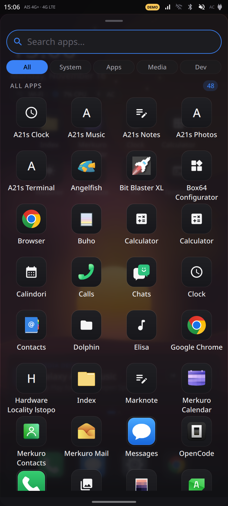

# Qt Quick GPU rendering and real-time blur on A21s

Verified on SM-A217F, 2026-11-16: kernel `7.3.0-g14a425b3a7dc-dirty`,
Mesa `1:26.2.6-1`, Qt base `6.12.0-5`, declarative `6.12.0-4`, labwc `0.20.2-1`.

**The hardware can run Qt Quick RHI/OpenGL and MultiEffect blur.** The ordinary
Qt software adaptation still cannot render shaders. The workaround changes
buffer allocation for an explicitly launched process; it does not add shader
support to Qt's software adaptation or fix arbitrary imports in exynos-drm.

## Shell integration

Deployed and verified on 2026-11-16. labwc autostart, `SystemControl.reloadShell()`
and the host reload/profiling commands now start `rabbiz-shell`. That entry point
checks the pinned Mesa path and available CMA before execing `a21s-qt-gpu quickshell`;
a failed gate or less than 96 MiB CMA starts the software glass fallback. The
floor is configurable with `RABBIZ_SHELL_CMA_FLOOR_KB` for explicit diagnostics.
The session and systemd unit still export software
as the default for ordinary apps.

- `Widgets/BackdropBlur.qml` samples an explicit source rectangle at half
  resolution and applies MultiEffect blur plus a rounded mask, then Theme tint.
  The Loader instantiates effects only with `GraphicsInfo.OpenGL`; software
  keeps the translucent Rectangle. Source items must exclude the effect itself.
- Dock samples wallpaper; drawer samples `desktopScene` (wallpaper + home
  content, excluding the drawer). These remain live. `desktopScene` must contain
  those children physically: Quickshell PanelWindow reparents its direct items,
  so assigning their `parent:` from outside the scene is insufficient.
- Shade captures the whole screen **once per opening**, before its own panel is
  visible, then freezes it while the blur is rendered on GPU. It releases that
  capture at close. This includes the app or home that was behind it; it does
  not update that underlying app's animation while the shade remains open.
  Capture failure has a 250 ms deadline and falls back to the ordinary tint.
- Shade keeps its swapchain at 720×1600; the clipped content and input `Region`
  follow the drag. Do not restore per-frame window resizing: each new size needs
  new contiguous scanout buffers.
- The shell sets `QS_DISABLE_DMABUF=1`. This disables Quickshell's **separate**
  screencopy allocator, so captures use SHM upload; it does not disable Qt RHI
  window rendering. The pinned EGL allocator applies to Qt's window buffers.
- `Appearance.appEnvironment` removes the private Mesa/preload/DRI overrides and
  resets Qt Quick to software on normal desktop-entry, music and Settings launch
  paths. It also sets `RABBIZ_FORCE_SOFTWARE=1` so the concurrently added
  `a21s-qt-render` app wrapper cannot opt back into GPU on those launches.
  Terminal entries use installed `gtk-launch` with that same environment.

Device verification used `scripts/verify_shell_blur.sh` under the shared remote
lock described in [DEVICE-QUEUE.md](../../../../docs/DEVICE-QUEUE.md). Ten shade/drawer open-close
cycles passed after the final cold boot with ID `61e37a65-7d1b-4c47-9cf0-8d1013275794`
and shell PID `1174` unchanged. Warm and final DMA-BUF totals were both **74 objects,
108,597,248 bytes**; CMA free remained `181,544 kB`. An earlier same-PID run also
passed with 134 objects / 215,576,576 bytes before the app-force-software flag landed.
No new matching import, CMA allocation, or Panfrost
fault/timeout kernel errors appeared in that interval. These are stability checks,
not a measured shell FPS or thermal endurance benchmark.

After waking/unlocking the device, injected touch gestures also opened the shade
from the top edge (`progress: 1`, `captured: true`) and opened the drawer by swiping
up from home (`open: true`, `progress: 1`). This checks that the full-size shade's
input mask leaves home gestures usable when collapsed; the test then closed both.

Kalk launched through the shell was inspected in `/proc/<pid>/environ`:
`QT_QUICK_BACKEND=software`; `QSG_RHI_BACKEND`, `LD_PRELOAD`,
`__EGL_VENDOR_LIBRARY_FILENAMES`, `DRI_PRIME`, both `RABBIZ_EXYNOS_*` variables and
`QS_DISABLE_DMABUF` were absent. After the concurrent `a21s-qt-render` wrapper was
added, a fresh shell-launched Settings process (PID `1705`) additionally verified
`RABBIZ_FORCE_SOFTWARE=1`, software rendering, and no private Mesa overrides. Kalk
was visibly mapped before the final cross-window shade capture. The shell reported
GPU rendering and a fresh 720×1600 shade capture. Five host tests cover the original Mesa version gate,
shell GPU/software startup selection and low-CMA startup fallback;
`scripts/check.sh` and ShellCheck pass.

Earlier experimental runs encountered allocation exhaustion and import failures,
and multiple other tasks changed files, applications and even rebooted the device
during investigation. Those mixed runs are not valid evidence for assigning a
single root cause. Cold boot and the later bounded, same-PID tests above establish
the current integration's tested scope. Long-duration use, repeated complete shell
restarts under memory pressure and suspend/resume remain unverified beyond the
startup guard. Low-CMA software recovery was exercised on the device before the
final cold boot. Cold-boot runtime-state FileView warnings and an existing host-portal registration warning
are separate from blur; they were not silently treated as a clean log.



[Home and dock capture](../../../../docs/rabbiz-shell-blur-home.png) ·
[Shade capture](../../../../docs/rabbiz-shell-blur-shade.png) ·
[Shade over a real Kalk window](../../../../docs/rabbiz-shell-blur-over-app.png)

Run again on an unlocked desktop:

```sh
./scripts/verify_shell_blur.sh root@172.16.42.1 /tmp/rabbiz-shell-blur
```

Runtime contract evidence: installed Qt 6.12 `QtQuick/Effects/plugins.qmltypes`
(`source`, blur, mask); `QtQuick/plugins.qmltypes` (`GraphicsInfo`,
`ShaderEffectSource`); Quickshell 0.3.2 `_Screencopy/*.qmltypes` (`live`,
`captureSource`, `hasContent`, `sourceSize`), `Io/*.qmltypes` (Process environment),
and `_Window/*.qmltypes` (`mask`). Quickshell v0.3.2 `view.cpp` confirms a new
captureSource creates a fresh context and `live: false` stops repeated capture;
`proxywindow.cpp` delegates the Region to QWindow's mask. The actual device tests
above verify these contracts together.

## Root cause and successful path

1. Mesa Wayland `get_back_bo()` normally asks for `__DRI_IMAGE_USE_SHARE |
   __DRI_IMAGE_USE_BACKBUFFER` (`0x11`). Normal windows need not get a SCANOUT
   feedback tranche. Panfrost therefore allocates physically scattered memory;
   exynos-drm has no display IOMMU and rejects that imported buffer.
2. Adding `__DRI_IMAGE_USE_SCANOUT` (`0x13`) selects the Panfrost renderonly
   allocation path: Exynos allocates a contiguous dumb buffer, exports it, and
   Panfrost imports it for GPU rendering. Intermediate shader textures stay on
   Panfrost; only window buffers need the display-compatible allocation.
3. A second issue appears: Mesa opens `/dev/dri/renderD128` for Exynos, where
   `DRM_IOCTL_MODE_CREATE_DUMB` returns `EACCES`. The process-local open shim
   redirects exactly that resolved node to the Exynos **primary** node. It does
   not take DRM master, change KMS state, or stop labwc.

```text
Exynos primary node -> contiguous dumb buffer -> dma-buf
    -> Panfrost imports and renders Qt UI + blur
    -> labwc imports -> Exynos display
```

`DRI_PRIME=platform-exynos-drm` alone does NOT fix this: verified to produce
the original Wayland error 7. SCANOUT alone fails CREATE_DUMB and the probe
segfaults. Both allocation changes are required in the tested configuration.

## Install and use

From the checkout on the host:

```sh
./scripts/setup_qt_scanout.sh root@172.16.42.1
```

Requires the device's existing `gcc`, Python 3 and Mesa; no download or package
upgrade. Creates `/usr/local/lib/a21s-qt-scanout/` and `/usr/local/bin/a21s-qt-gpu`.
The system Mesa library, kernel and default session environment stay unchanged.
On the device, as the desktop user:

```sh
XDG_RUNTIME_DIR=/run/user/1001 WAYLAND_DISPLAY=wayland-0 \
  QT_FORCE_STDERR_LOGGING=1 QSG_INFO=1 \
  a21s-qt-gpu qml6 /usr/local/lib/a21s-qt-scanout/Probe.qml

# Same process-local path for a Qt Quick app, including an explicit quickshell run:
a21s-qt-gpu your-qt-application
```

For SSH, run through `runuser -u rabbiz -- env ...` as in the project's other
device probes. The user must have access to the Exynos primary node (video group).
Do not launch a second shell over the first or stop labwc to try this path.

## Evidence

| Probe | Outcome |
|---|---|
| RHI/OpenGL + `LIBGL_ALWAYS_SOFTWARE=1`, 360×480, 12 rotating rectangles | llvmpipe, 77 animation callbacks / 5 s; shaders work but slow |
| Stock Mesa, RHI/Panfrost + explicit Exynos DRI_PRIME | Wayland error 7, exit 255 |
| Private SCANOUT EGL + primary-node shim, 360×480 | Mali-G52 MC1 (Panfrost), 300 callbacks / 5 s, exit 0 |
| Same, 720×1600, 12 rectangles | 601 callbacks / 10 s, exit 0 |
| Installed wrapper, 720×1600, 48 rotating rectangles, MultiEffect `blurMax: 32`, `blur: 1` | 600 callbacks / 10 s; repeat visible on display: 601 / 10 s, exit 0 |
| `--static --sharp` probe | GPU capture succeeds, exit 0 |
| Three further launch/render/exit cycles with installed wrapper | 601 callbacks / 10 s each; all exit 0; no new matching import, swiotlb or Panfrost fault/timeout kernel errors |

These are Qt FrameAnimation callback counts (~60/s), **not measured panel FPS,
presentation latency or sustained thermal performance**. The visible probe's
`grim` capture confirms real blur on the composed screen. `contentItem.grabToImage`
also succeeds, including while the shell lock screen obscures the test window.
The visible run emitted one Qt text-input focus warning, no dmabuf import error.
The kernel's earlier stock-path failure remains in the same boot's log.


Probe flags (after `qml6 Probe.qml --`): `--static` stops rotation; `--sharp`
disables blur. Captures save to `/tmp/a21s-blurred.png` or `/tmp/a21s-sharp.png`.
The window exits after 10 seconds. Source is [Probe.qml](../../../../tools/qt-scanout/Probe.qml).

## Scope, version gate, rollback

This is an **experimental, opt-in binary proof**, not a portable Mesa release.
The patcher requires this exact system-library SHA-256:

```text
539e44a926ddfc5ba562a11e07d18205fec08a08c57c3cebe5f3070e6082b789
```

Disassembly identifies two ordinary-buffer assignments in `get_back_bo()`:
file offsets `0x2d518`, `0x2d864`: `mov w22,#0x11` (`0x52800236`) becomes
`mov w22,#0x13` (`0x52800276`). The executable LOAD segment's file offset equals
its virtual address. Protected-content and cross-GPU copy branches are not patched
or supported. The wrapper pins Exynos and checks **both original and private EGL
checksums on every invocation**. Mesa upgrades fail closed and require porting the
patch; never remove the version guard to get around this.

Both launcher rejection paths were exercised with isolated fixture directories:
wrong original-library checksum and corrupt private-library checksum both refuse
to execute the requested command. Host tests also verify that an unsupported
binary leaves the source untouched and creates no destination. `scripts/check.sh`
and ShellCheck pass. Installation compiled the shim with `-Wall -Wextra -Werror`.

Primary-node access uses the session's existing device permissions. The shim
covers Mesa's tested `open`/`open64` calls, not every possible file API. CMA
pressure, longer runs, suspend/resume, multiple large windows, every Qt app,
Chromium remains unverified. Persistent shell startup and backdrop integration
are now verified within the bounded tests above; this is still an experimental
Mesa path rather than a general exynos-drm import fix.

Rollback: close the experimental app and launch it normally with
`QT_QUICK_BACKEND=software`. To uninstall, remove only
`/usr/local/bin/a21s-qt-gpu` and `/usr/local/lib/a21s-qt-scanout/`.

The next maintainable implementation is a Mesa source fix for opt-in scanout
allocation plus kmsro primary-node selection. A source equivalent for the first
half is in [patches/mesa](../../../../patches/mesa/0001-wayland-opt-in-scanout-buffers.patch);
it has been checked against Mesa 26.2.6 source but **not compiled**. The current
binary experiment intentionally avoids rebuilding all of Mesa on the nearly full
device rootfs.

## Upstream references

- [Qt software adaptation](https://doc.qt.io/qt-6/qtquick-visualcanvas-adaptations-software.html): ShaderEffect is unsupported on that backend.
- [Mesa 26.2.6 Wayland EGL source](https://gitlab.freedesktop.org/mesa/mesa/-/blob/mesa-26.2.6/src/egl/drivers/dri2/platform_wayland.c): `get_back_bo()` and feedback allocation flags.
- [Panfrost resource allocation](https://gitlab.freedesktop.org/mesa/mesa/-/blob/mesa-26.2.6/src/gallium/drivers/panfrost/pan_resource.c): renderonly/SCANOUT allocation.
- [Renderonly dumb allocation](https://gitlab.freedesktop.org/mesa/mesa/-/blob/mesa-26.2.6/src/gallium/auxiliary/renderonly/renderonly.c): CREATE_DUMB and dma-buf export.
