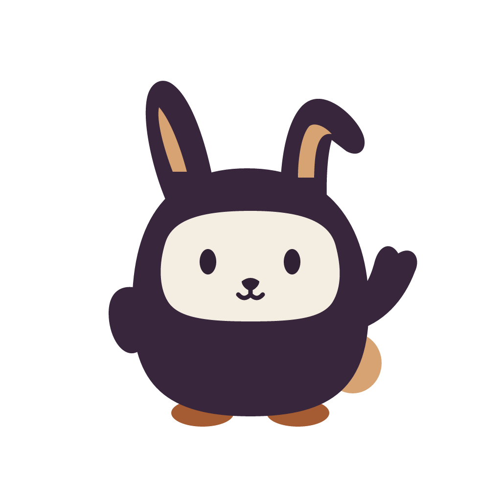
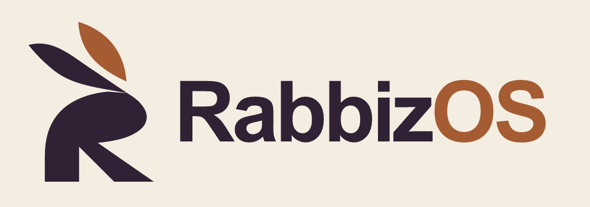
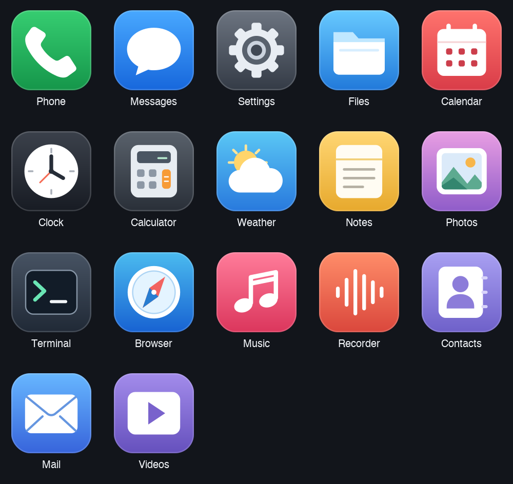

# RabbizOS brand & assets

RabbizOS is an independent, experimental Arch Linux ARM–based mobile Linux system
by Devded. **Rabbiz** is its rabbit mascot. **Rabbiz Mirror** is its native macOS
screen-sharing companion. Use these spellings in public-facing copy.

The name describes our integrated system, shell, hardware ports, and tools. Linux,
Arch Linux ARM, and other upstream components retain their names and licenses.
RabbizOS is not an official SteamOS release. This naming work does not establish
trademark availability or change the licensing of existing code or firmware.

## Character

Rabbiz is a friendly, curious plum rabbit with a compact bean-shaped silhouette:
head and body are one continuous shape, with no neck or separate torso. One thick
ear stands upright; the other folds outward. A large cream face panel, small dark
oval eyes, tiny rabbit nose and soft mouth carry its expressions. Short mitten
paws, tiny foot nubs and a small tail complete the shape. No clothing or belly
panel is needed. The canonical flat character uses solid fills, without gloss,
fur texture, gradients or 3D shading.

The mascot references inform proportions, soft geometry and expressive gestures.
Keep Rabbiz recognizably a rabbit, with its own face panel and silhouette. The
palette follows the owner’s Rabbiz.AI logo reference: dark plum, copper and warm
cream, with a sand-colored icon tile.

## Logo

The separate brand logo follows the owner’s supplied rabbit/R reference: a plum
rabbit profile forms the letter **R**, with a copper leaf-shaped upright ear.
Use the logo and RabbizOS wordmark for project identity. Use the round mascot for
character illustrations and app icons. These are intentionally separate assets.

## Palette

| Role | Color |
|---|---|
| Facial details / badge background | `#302135` |
| Rabbit body | `#38263D` |
| Copper feet / props | `#A55C32` |
| Pale copper ears / tail | `#D7A373` |
| Warm cream face panel | `#F4EDE1` |
| Warm sand icon tile | `#DAC9B3` |

Prefer a warm sand icon tile with plum artwork and copper accents. Use a system
sans-serif for text; the rabbit symbol itself contains no lettering. The wordmark uses bold Arial with Helvetica/sans-serif fallbacks; its text remains editable in SVG. Keep the original
aspect ratio and leave clear space around the ears.

## Built-in app icons

The base-app set uses simple function symbols on softly graded rounded tiles,
without mascot artwork. All 17 icons share a 128 × 128 viewBox, a 30-unit corner
radius and generous symbol clear space. The launcher applies these icons by exact
desktop ID to equivalent Linux apps, without changing their commands or vendor files.

| Icon | Launcher desktop IDs |
|---|---|
| Phone | `rabbiz-dialer`, `org.gnome.Calls` |
| Messages | `rabbiz-sms`, `sm.puri.Chatty` |
| Settings | `rabbiz-settings`, `org.kde.mobile.plasmasettings` |
| Files | `rabbiz-files`, `org.kde.index`, `org.kde.dolphin` |
| Calendar | `rabbiz-calendar`, `org.kde.merkuro.calendar`, `org.kde.merkuro`, `org.kde.calindori` |
| Clock | `rabbiz-clock`, `org.kde.kclock` |
| Calculator | `rabbiz-calculator`, `org.kde.kalk` |
| Weather | `rabbiz-weather`, `org.kde.kweather` |
| Notes | `rabbiz-notes`, `org.kde.marknote`, `org.kde.buho` |
| Photos | `rabbiz-gallery`, `rabbiz-photos`, `org.kde.pix`, `org.kde.koko` |
| Terminal | `rabbiz-terminal`, `org.kde.qmlkonsole`, `org.kde.konsole` |
| Browser | `rabbiz-browser`, `google-chrome`, `chromium`, `org.kde.angelfish` |
| Music | `rabbiz-music`, `org.kde.elisa`, `org.kde.vvave` |
| Recorder | `rabbiz-recorder`, `org.kde.krecorder` |
| Contacts | `rabbiz-contacts`, `org.gnome.Contacts`, `org.kde.merkuro.contact`, `org.kde.merkuro.contacts` |
| Mail | `rabbiz-mail`, `org.kde.merkuro.mail`, `org.gnome.Geary` |
| Videos | `rabbiz-video`, `mpv`, `vlc` |

Editable SVG sources live in
`rootfs-overlay/usr/share/icons/hicolor/scalable/apps/a21s-*.svg`.
All repository-owned base-app `.desktop` entries also use these hicolor
icon names. Other apps receive the artwork in `Desktop/AppIcon.qml`, including
home-screen placeholders and the starting window. If an SVG fails to load, the
existing Material symbol or app-name initial remains available as a fallback.
Apps outside the table retain their existing icons. Do not match generic icon
names: that could accidentally give unrelated apps the same artwork.

Deploy these SVGs and `Desktop/AppIcon.qml` together. Refresh the icon cache with
`gtk-update-icon-cache -f -t /usr/share/icons/hicolor` when updating an existing
installation, then reload the shell to clear previously cached artwork.
Keep app IDs, commands and service names unchanged. This set changes artwork;
it does not install missing applications.

### Launcher duplicates

`Desktop/AppCatalog.js` selects one visible entry per base-app role before search
and category filtering. It prefers our native apps, Index for files, Merkuro for
calendar and GNOME Contacts for contacts. Alternatives remain installed; the next
available entry appears when the preferred one is missing or hidden. Duplicate
IDs are collapsed without conflating unrelated apps that share a display name.
HomeScreen explicitly prefers the native clock, calculator, notes, photos and
terminal IDs. Hidden compatibility entries stay available for older launch paths.

Device verification (2026-11-16): deployed all 17 SVGs and the catalog, reloaded
only the shell, and inspected the drawer screenshot. Its IPC model contained 28
unique IDs, all ten native/wrapped base entries, and none of the 13 installed
alternatives selected for suppression. `shell/tests/appcatalog.test.mjs` covers
priority, fallback, hidden entries and duplicate IDs.

## Files

| Asset | Editable source | Export | Use |
|---|---|---|---|
| Rabbit/R logo | [rabbizos-logo.svg](../assets/branding/rabbizos-logo.svg) | [PNG](../assets/branding/rabbizos-logo.png) | Primary logo, transparent |
| Symbol on cream | [rabbizos-logo-on-cream.svg](../assets/branding/rabbizos-logo-on-cream.svg) | [PNG](../assets/branding/rabbizos-logo-on-cream.png) | Square symbol-only version, no wordmark |
| RabbizOS wordmark | [rabbizos-wordmark.svg](../assets/branding/rabbizos-wordmark.svg) | [Transparent PNG](../assets/branding/rabbizos-wordmark.png), [on cream](../assets/branding/rabbizos-wordmark-on-cream.png) | Horizontal logo and project name |
| Rabbit mark | [rabbiz-mark.svg](../assets/branding/rabbiz-mark.svg) | [PNG](../assets/branding/rabbiz-mark.png) | Transparent compact mascot mark |
| System icon | [rabbizos-icon.svg](../assets/branding/rabbizos-icon.svg) | [PNG](../assets/branding/rabbizos-icon.png) | OS avatar and README |
| Flat full-body character | [rabbiz-mascot-flat.svg](../assets/branding/rabbiz-mascot-flat.svg) | [PNG](../assets/branding/rabbiz-mascot-flat.png) | Canonical 2D flat mascot |
| Six-pose character sheet | [rabbiz-poses.svg](../assets/branding/rabbiz-poses.svg) | [PNG](../assets/branding/rabbiz-poses.png) | Standing, waving, celebrating, thinking, resting, holding a tablet |
| Illustrated character | — | [Transparent PNG](../assets/branding/rabbiz-mascot-illustration.png) | Additional generated character artwork |
| Mirror app icon | [AppIcon.svg](../tools/rabbiz-mirror/Assets/AppIcon.svg) | [PNG](../tools/rabbiz-mirror/Assets/AppIcon.png), [ICNS](../tools/rabbiz-mirror/Assets/AppIcon.icns) | Rabbit with paired-screen badge |

SVG sources are self-contained. The pose sheet is 1536 × 1024 and the wordmark is 1024 × 360. Other vector PNG exports are 1024 × 1024 except the generated
illustration, which retains its original dimensions and transparency. The flat
SVG artwork is the source of truth for the mark and canonical character; the
illustrated character has softer shading and is a separate treatment.

After editing an SVG, export its PNG using an SVG renderer. For the macOS icon,
render 16, 32, 128, 256, and 512 px plus each size at 2× into an `AppIcon.iconset`
directory, then package it with `iconutil -c icns AppIcon.iconset`. Commit the
updated SVG, PNG, and ICNS together. Normal app builds use the committed ICNS
and require no image-generation service or extra runtime dependencies.

## Naming and implementation

The repository directory may still be `android-arm-linux`. Device commands,
services, QML modules, paths, and Swift target names such as `rabbiz-shell`,
`Rabbiz.*`, `tools/rabbiz-mirror`, and `RabbizMirror` are the technical names (pre-rename: `A21s.*`, `a21s-mirror`, `A21sMirror`).
Historical research records and paths are preserved. The branding changes do not
rename the remote repository or change the device's installed OS metadata.

Build the companion with `./scripts/build_mac_app.sh`; the result is
`dist/Rabbiz Mirror.app`. The existing bundle identifier `com.devded.mirrorapp`
is preserved for continuity with macOS Local Network permissions.

## Illustration provenance

The illustrated PNG was generated using the built-in imagegen tool. The owner’s supplied images establish the compact character style and plum/copper/cream palette; the canonical SVG defines the production character. The SVG
mark, system icon, flat character, and companion icon were authored as editable
vector artwork for this repository. The illustration prompt is recorded in
[rabbiz-mascot-prompt.txt](../assets/branding/rabbiz-mascot-prompt.txt).
