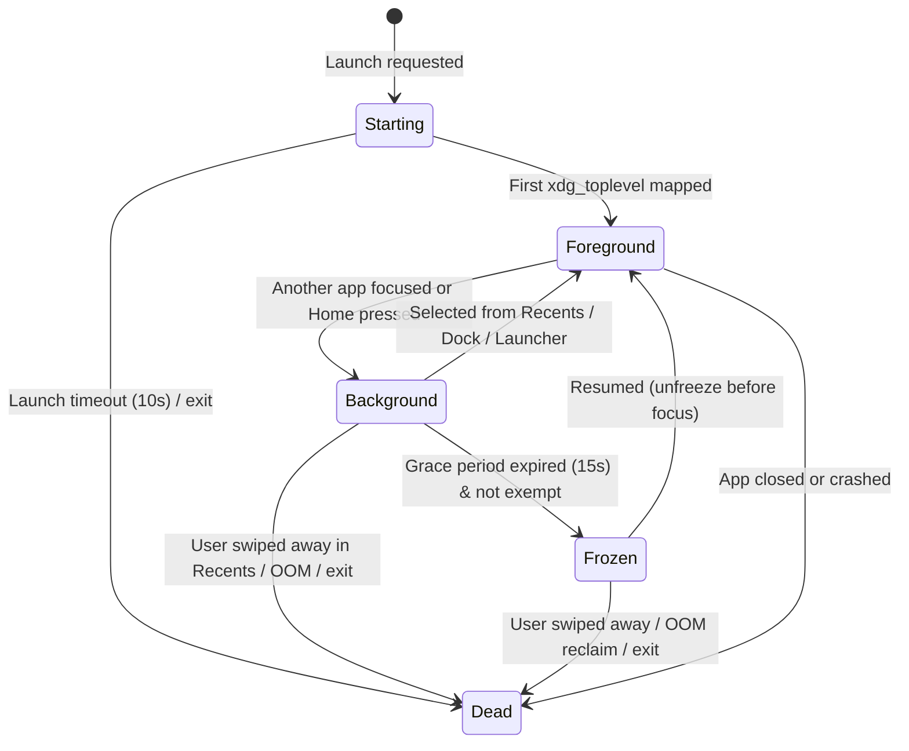

# RFC: App Lifecycle, cgroup v2 Scopes & OOM Policy (`rabbiz-de`)

- **Status:** Draft RFC (Concept — ready for owner review before implementation)
- **Lane:** `de` (with userland systemd drop-ins)
- **Target crates:** `de-apps`, `de-system`, `de-core`
- **Target hardware constraint:** Samsung Galaxy A21s (`2.8 GiB` usable RAM, Exynos 850, no discrete swap partition by default; zram only)
- **Related:** [DE-SEAMS.md](DE-SEAMS.md), [DE-IPC.md](DE-IPC.md), [ARCHITECTURE.md](ARCHITECTURE.md)

---

## 1. Problem Statement

Today, `rabbiz-de` spawns applications as direct child processes of the compositor session. On a `2.8 GiB` RAM mobile Linux device, this creates four concrete failure modes:

1. **Compositor OOM collateral damage:** Without isolated cgroup v2 scopes and `oom_score_adj` separation, a heavy browser tab (`chromium` / `firefox`) can trigger the kernel OOM killer and take down `rabbiz-de` or `rabbiz-osk`, crashing the entire session.
2. **Background battery & CPU drain:** An app left in Recents continues running timers, animations, and JS loops at full CPU priority even when off-screen.
3. **Uncontrolled memory growth:** Background apps hold hundreds of megabytes of anonymous memory with no soft pressure (`MemoryHigh`) to encourage reclaim before hitting hard OOM.
4. **Orphaned helper processes:** Closing an app's Wayland toplevel sends `xdg_toplevel.close`, but misbehaving apps or spawned sub-processes can linger in the background indefinitely.

---

## 2. Mobile App Lifecycle State Machine

Model every launched application in `de-core` through a 5-state lifecycle inspired by Android ActivityManager + systemd user scopes:

### State Policies (cgroup v2 + OOM + CPU)

| State | systemd Scope | `oom_score_adj` | `CPUWeight` | `MemoryHigh` | `cgroup.freeze` |
|---|---|---|---|---|---|
| **Session Core** (`rabbiz-de`, `rabbiz-osk`, `pipewire`) | `rabbiz-session.service` | `-800` | `200` | unlimited | `0` (never frozen) |
| **Starting** | `app-rabbiz-<id>-<uuid>.scope` | `100` | `150` | `70%` RAM | `0` |
| **Foreground** | `app-rabbiz-<id>-<uuid>.scope` | `100` | `150` | `70%` RAM | `0` |
| **Background** (grace 15 s) | same scope | `400` | `50` | `40%` RAM | `0` |
| **Frozen** | same scope | `700` | `10` | `25%` RAM | `1` (frozen) |

### Freeze Exemptions (Never Freeze)

An app in `Background` MUST NOT be frozen if any of the following holds:
1. **Active audio / MPRIS playback** — app PID/cgroup owns an active PipeWire playback stream or reports MPRIS `PlaybackStatus == "Playing"`.
2. **Active voice call / modem session** — `rabbiz-dialer` while a call is active.
3. **Active Wayland idle inhibitor** — surface holds a `zwp_idle_inhibitor_v1` (already tracked in `de-core/src/protocols/idle_inhibit.rs`).
4. **Active download / foreground service opt-in** — explicit exemption list in `de-config` (e.g., `rabbiz-terminal` while a child job is running, or user-pinned apps).

---

## 3. Launch & Scope Management (`de-system/src/lifecycle.rs`)

### 3.1 Spawning via `systemd --user` Transient Scopes

Instead of raw `Command::spawn()` inheriting `rabbiz-de`'s cgroup:

1. `de-system/src/lifecycle.rs` launches apps via `org.freedesktop.systemd1.Manager.StartTransientUnit` on the user bus (falling back cleanly to direct `Command::spawn` on non-systemd dev hosts / macOS):
   - Unit name: `app-rabbiz-<sanitized_app_id>-<instance_id>.scope`
   - Slice: `app-rabbiz.slice` (bounded aggregate memory ceiling so user apps as a group cannot starve `rabbiz-session.service`)
   - Properties: `OOMPolicy=kill`, `ManagedOOMMemoryPressure=kill` (when `systemd-oomd` is active), `CollectMode=inactive-or-failed`.
2. **Reliable PID ↔ Wayland Client mapping:**
   - Smithay gives `Client::get_credentials(&display_handle)` → `pid`.
   - Read `/proc/<pid>/cgroup` once when the first `xdg_toplevel` maps to bind the Wayland window to its `ScopeHandle`.
3. **Clean termination on Recents swipe-away:**
   - Send `xdg_toplevel.close`.
   - Start a 3-second grace timer.
   - If the scope is still active after 3 s (or was frozen), unfreeze and call `StopUnit` (`SIGTERM` → `SIGKILL` for the entire cgroup, leaving zero orphan children).

### 3.2 Unfreeze-Before-Input Guarantee

When the user taps a `Frozen` app in Recents or Launcher:
1. Immediately write `0` to `cgroup.freeze` (via systemd `FreezeUnit`/`ThawUnit` or direct cgroup v2 control on delegated user slice).
2. Send `xdg_toplevel.configure` + surface frame callback only **after** thaw completes.
3. Show the app's last Recents thumbnail as the starting window morph until the thawed client commits its first fresh frame (eliminating black flashes).

---

## 4. Memory Pressure Integration (`2.8 GiB` Guardrails)

On A21s, combine three lightweight layers:
1. **Kernel PSI (`/proc/pressure/memory`):** `de-system` monitors `some avg10` via pollable PSI trigger (`some 150000 1000000` — 150 ms stall per 1 s).
2. **Proactive trim on pressure:** When PSI fires, `de-core` evicts the oldest `Frozen` app (LRU order in Recents, keeping its Recents card as a cold-relaunch stub with saved snapshot) *before* the kernel OOM killer triggers.
3. **User-visible feedback:** Never silently vanish the foreground app; if a background app is reclaimed, its Recents card stays visible and seamlessly cold-starts on tap (matching Android's Process Death + Recents model).

---

## 5. Crate Boundary & Seam Plan

- `de-system/src/lifecycle.rs` (new): pure state machine (`LifecyclePolicy`, `AppState`, LRU eviction planner — 100% host-testable on macOS) + Linux systemd user D-Bus / cgroup v2 backend behind `#[cfg(target_os = "linux")]`.
- `de-core/src/runtime/`: hooks `on_toplevel_mapped`, `on_focus_changed`, `on_recents_dismiss`, and a 1 s tick to transition `Background → Frozen` after grace period.
- `de-config/src/ipc.rs`: optional `rabbiz-de ctl lifecycle` diagnostic subcommand to inspect active scopes, states, and RSS on device.

---

## 6. Verification Plan

1. **L0 (macOS host):** Unit tests for the pure lifecycle state machine:
   - Transition table (`Starting → Foreground → Background → Frozen → Foreground`).
   - Exemption rules (MPRIS playing / idle inhibitor / dialer call prevents freeze).
   - LRU eviction under simulated memory pressure (skips foreground & exempt apps, evicts oldest frozen first).
2. **L1 (`rabbiz-de-build:arm64`):** Compile systemd D-Bus & `/proc/<pid>/cgroup` integration cleanly.
3. **L2 (A21s on-device):**
   - Launch 5 apps (`rabbiz-files`, `rabbiz-calculator`, `rabbiz-notes`, `rabbiz-music`, `chromium`).
   - Verify `systemctl --user list-units 'app-rabbiz-*.scope'` shows isolated scopes.
   - Verify background non-audio app enters `Frozen` after 15 s (`cat /sys/fs/cgroup/.../cgroup.freeze == 1`) while `rabbiz-music` stays unfrozen while playing.
   - Verify tapping the frozen app in Recents thaws and resumes in `< 200 ms`.
