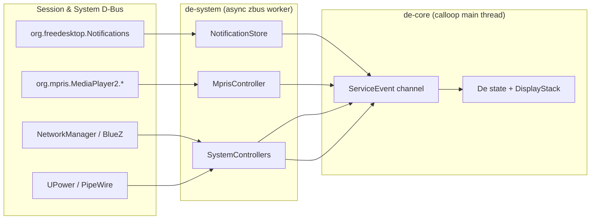

# RFC: Notification Pipeline & Reactive Service Bus (`rabbiz-de`)

- **Status:** Draft RFC (Concept — ready for owner review before implementation)
- **Lane:** `de`
- **Target crates:** `de-system`, `de-ui`, `de-core`, `de-config` (no breaking changes to frozen `de-api` v1.1)
- **Related:** [DE-SEAMS.md](DE-SEAMS.md), [DE-SCENE-INSETS.md](DE-SCENE-INSETS.md), [DE-KEYGUARD-AUTH.md](DE-KEYGUARD-AUTH.md)

---

## 1. Problem Statement

Today, `tools/rabbiz-de/crates/de-system/src/notifications.rs` implements a minimal `org.freedesktop.Notifications` v1.3 server with three major gaps compared to a mobile shell (Android SystemUI / Phosh):

1. **No rich notification lifecycle:**
   - `get_capabilities()` only advertises `["body"]` — `_actions: Vec<String>` and `_app_icon: &str` are discarded.
   - No **Heads-Up Notification (HUN)** banner when a high-urgency / incoming-call / message notification arrives while an app is in foreground.
   - No **grouping by `app_name`** (5 messages from the same chat app flood the shade instead of collapsing into an expandable stack).
   - No **lockscreen redaction** (sensitive notification body is shown verbatim on the lock screen regardless of user privacy preference).
2. **No MPRIS media control card:**
   - Media players (Spotify, `rabbiz-music`, browsers) expose `org.mpris.MediaPlayer2.Player` on session D-Bus, but the shade has no unified Now Playing card (play/pause, next/prev, track/artist, album art).
3. **Polling-heavy system state:**
   - Several hardware/service states in `de-system` (`controls.rs`, `upower.rs`, `privacy.rs`) are refreshed by periodic polling rather than push signals waking the `calloop` event loop only on change — wasting wakeups on battery.

---

## 2. Architecture Overview

### 2.1 Push-Based Service Bus (`de-system` → `de-core` `calloop`)

Every system controller runs on a dedicated background Tokio/zbus worker inside `de-system` and emits immutable **state snapshots** over a `calloop::channel` (or `std::sync::mpsc` + `eventfd` ping) so the compositor event loop **never blocks on D-Bus** and **never polls** when idle:



```rust
/// Unified push events from `de-system` to `de-core`.
pub enum ServiceEvent {
    NotificationsChanged { generation: u64, hun: Option<u32> },
    MediaChanged(MediaSnapshot),
    PowerChanged(PowerSnapshot),
    NetworkChanged(NetworkSnapshot),
    AudioChanged(AudioSnapshot),
}
```

### 2.2 Notification Data Model Upgrade (`de-system/src/notifications.rs`)

Extend `Entry` (bounded, session-only, never logged or persisted to disk — preserving existing privacy invariant):

```rust
#[derive(Clone, Copy, Debug, PartialEq, Eq)]
pub enum Urgency {
    Low = 0,
    Normal = 1,
    Critical = 2,
}

#[derive(Clone, Debug, PartialEq, Eq)]
pub struct NotificationAction {
    /// Wire key returned via `ActionInvoked(id, key)` D-Bus signal.
    pub key: String,
    /// Human-readable button label (bounded to 32 chars).
    pub label: String,
}

#[derive(Clone, Debug)]
pub struct Entry {
    pub id: u32,
    pub app: String,
    pub desktop_entry: Option<String>, // from hint "desktop-entry"
    pub category: Option<String>,      // from hint "category" (e.g. "call.incoming", "im.received")
    pub title: String,
    pub body: String,
    pub urgency: Urgency,              // from hint "urgency"
    pub resident: bool,                // from hint "resident"
    pub transient: bool,               // from hint "transient"
    pub actions: Vec<NotificationAction>, // max 3 buttons
    pub created: Instant,
    expires: Option<Instant>,
}
```

**Advertised capabilities:** `["body", "actions", "persistence", "action-icons"]`.

**D-Bus signals emitted by `Service`:**
- `NotificationClosed(id: u32, reason: u32)` — `1` expired, `2` dismissed by user, `3` closed by `CloseNotification`, `4` undefined.
- `ActionInvoked(id: u32, action_key: &str)` — emitted when the user taps an action button or the card body (`"default"` action).

### 2.3 Heads-Up Notification (HUN) Policy

A newly arrived notification triggers a floating banner in `DisplayArea::NotificationHun` (above apps & status bar, below `PowerMenu` & `Keyguard` — see [DE-SCENE-INSETS.md](DE-SCENE-INSETS.md)):

| Condition | Show HUN? | Auto-dismiss timeout |
|---|---|---|
| `Urgency::Critical` or `category == "call.incoming"` | Yes (even over DND for calls/alarms) | Persistent until acted on or dismissed |
| `Urgency::Normal` + DND off + shade closed + unlocked | Yes | 5 seconds (paused while finger is touching) |
| `Urgency::Low` or DND on or shade already open | No (goes silently into shade) | — |
| Screen locked (`Keyguard` active) | No HUN banner; updates lockscreen preview cards | — |

**Gestures on HUN banner:**
- **Swipe up** → dismisses banner only (keeps notification in shade).
- **Swipe left/right** → dismisses notification completely (`NotificationClosed(id, 2)`).
- **Tap body** → invokes `"default"` action (or launches `desktop_entry`), closes HUN.
- **Tap action button** → invokes `ActionInvoked(id, key)`.

### 2.4 App Grouping & Lockscreen Redaction

1. **Grouping in `de-ui/src/screens/panels.rs`:**
   - Pure function `group_notifications(entries: &[Notification]) -> Vec<NotificationGroup>` keyed by `desktop_entry.or(app)`.
   - Single-entry group renders as a normal card; multi-entry group renders as a stacked header card (`"App Name · 4 messages"`) with expand/collapse toggle and a single swipe-to-clear-group action.
2. **Lockscreen Privacy (`de-config::Prefs::lockscreen_notifications`):**
   - `ShowAll`: title + body visible on lockscreen.
   - `HideSensitive` (default when PIN/Pattern enabled): shows app name + `"New notification"` on lockscreen; reveals full content once unlocked.
   - `HideAll`: no cards on lockscreen, status bar dot only.

### 2.5 Unified MPRIS Media Card

`de-system/src/mpris.rs` watches `NameOwnerChanged` for `org.mpris.MediaPlayer2.*` on session D-Bus and tracks the most recently active player:

```rust
#[derive(Clone, Debug, Default, PartialEq, Eq)]
pub struct MediaSnapshot {
    pub bus_name: String,
    pub player_name: String,
    pub title: String,
    pub artist: String,
    pub playing: bool,
    pub can_go_next: bool,
    pub can_go_previous: bool,
    pub art_path: Option<String>, // local file:// only; never fetch remote HTTP
}
```

- Rendered in `Shade` (above notification list) and optionally on `LockScreen` (when `playing == true`).
- Commands (`PlayPause`, `Next`, `Previous`) sent asynchronously via `de-system` worker channel.
- Security rule: `mpris:artUrl` only accepts local `file://` paths under `$XDG_CACHE_HOME` or `$XDG_RUNTIME_DIR` (max 2 MiB); remote `http(s)://` URLs are ignored to prevent compositor SSRF/network stalls.

---

## 3. Phased Implementation Plan

1. **Phase 1 (L0 host-tested):**
   - Parse `actions`, `urgency`, `desktop-entry`, `category`, `resident` hints in `de-system/src/notifications.rs` + emit `NotificationClosed` & `ActionInvoked`.
   - Add pure `group_notifications()` and `redact_for_lockscreen()` functions in `de-ui` with unit tests.
2. **Phase 2 (L0 + L1 arm64 container):**
   - Add `HunState` state machine in `de-ui/src/interaction/` (queue, 5 s timer, swipe-up snooze vs swipe-horizontal dismiss) + render in `DisplayArea::NotificationHun`.
   - Add `de-system/src/mpris.rs` + shade media card in `de-ui/src/screens/panels.rs`.
3. **Phase 3 (L2 on-device verification on A21s):**
   - Verify with `notify-send -u critical -A "reply=Reply" "Test" "Hello"` and `rabbiz-music` MPRIS playback.
   - Verify lockscreen redaction under `HideSensitive` and `HideAll`.
