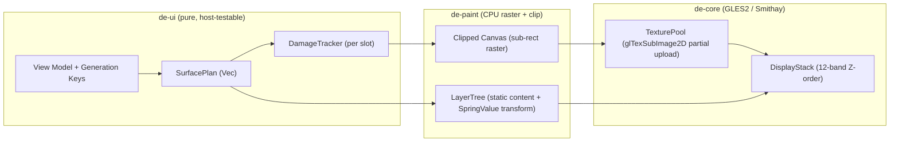

# RFC: Retained UI, Dirty-Rect Damage & Layer Caching (`rabbiz-de`)

- **Status:** Draft RFC (Concept — ready for owner review before implementation)
- **Lane:** `de`
- **Target crates:** `de-paint`, `de-ui`, `de-core` (no breaking changes to frozen `de-api` v1.1)
- **Related:** [DE-SEAMS.md](DE-SEAMS.md), [DE-SCENE-INSETS.md](DE-SCENE-INSETS.md), [HANDOFF-de-audit-2026-11-19.md](HANDOFF-de-audit-2026-11-19.md)

---

## 1. Problem Statement

On the Samsung Galaxy A21s (Exynos 850, 8× Cortex-A55, Mali-G52 MP1, 720×1600 @ 60 Hz):

1. Every shell surface (`status`, `shade`, `home`, `drawer`, `recents`, `lock`, `osd`) is currently rasterized on the CPU into a full-screen premultiplied RGBA `Pixels` buffer (`720 × 1600 × 4 = 4.6 MiB`) whenever any bit of its view model changes — even when only a clock minute ticks, a battery icon updates, or a single notification card slides.
2. Each full-screen re-rasterization triggers a full `4.6 MiB` GL texture upload (`glTexImage2D`) over shared system RAM, burning CPU cycles, memory bandwidth, and battery on a single-core Mali-G52.
3. `de-paint` already contains [`DamageTracker`](../tools/rabbiz-de/crates/de-paint/src/damage.rs) and [`Layer` / `LayerTree`](../tools/rabbiz-de/crates/de-paint/src/layer.rs) from M2-T4, but neither `de-ui` nor `de-core/src/runtime/textures.rs` currently exploits sub-rect rasterization or partial GPU uploads.

**Goal:** Reduce idle/minor-update shell frame CPU cost by >80% and eliminate full-screen texture re-uploads during animations (shade drag, drawer scroll, recents peek, clock/battery ticks, OSD updates) while keeping `de-ui` pure, deterministic, and 100% host-testable (`de-sim`).

---

## 2. Non-Goals

- Replacing `tiny-skia` / CPU rasterization with a custom GPU UI shader engine (too complex for M1–M6 and breaks deterministic `de-sim` golden PNGs).
- Introducing a retained DOM / general-purpose CSS layout engine.
- Modifying frozen `de-api` types (`Pixels`, `Rect`, `Size`, `DisplayArea` already suffice).

---

## 3. Architecture Overview

Split shell rendering into **three tiers of caching**, matching how Android SurfaceFlinger / SystemUI and modern Wayland shells separate content rasterization from composition:



### Tier A — Static Surface Decomposition (Already-Known Geometry)

Instead of painting a single `720 × 1600` buffer for a composite screen, decompose high-churn chrome into independent `de-paint::Layer` surfaces placed in `DisplayStack`:

| Surface Slot | Typical Size (720×1600) | Invalidation Trigger | Placement Animation |
|---|---|---|---|
| `Wallpaper` | 720×1600 (static) | Wallpaper/theme change only | GPU scale/parallax only (never re-raster) |
| `StatusBar` | 720×72 (~200 KiB) | Clock minute, battery %, signal, DND | GPU opacity/y-offset |
| `HomeGrid` | 720×1280 | Icon order/app list change only | GPU translate/scale on launch morph |
| `HomeDock` | 720×180 (~500 KiB) | Dock membership/badge change | GPU translate/opacity |
| `ShadeHeader` | 720×420 | QS toggle state, brightness slider | GPU translate (`shade_y`) |
| `NotificationCard[id]` | 672×148 (~390 KiB each) | Per-notification `generation` key | GPU translate/swipe-x/alpha |
| `NavBar` | 720×48 (~135 KiB) | Pill contrast / orientation only | GPU alpha |
| `OsdPill` | 280×72 (~80 KiB) | Volume/brightness value change | GPU scale/alpha |

**Immediate win:** Moving the shade, swiping a notification card, or launching an app becomes **0 bytes of CPU rasterization and 0 bytes of texture upload** — only GPU quad transforms on already-uploaded textures.

### Tier B — Keyed Sub-Region Dirty Rects (Inside a Single Surface)

For surfaces with localized updates (e.g., `StatusBar` clock ticks, `Settings` toggle flips, `LockScreen` charging text):

1. Introduce a lightweight `DirtyKey` hash per logical widget region inside `de-ui`:
   ```rust
   /// Pure retained-cache hint kept per screen in `de-ui`.
   #[derive(Default)]
   pub struct RegionCache {
       /// widget_id -> (content_hash, last_bounds)
       regions: Vec<(u32, u64, Rect)>,
   }
   ```
2. On each frame, `RegionCache::diff(id, hash, bounds)` compares `(hash, bounds)` against the previous frame:
   - Unchanged → skip painting this region.
   - Changed → add `old_bounds` and `new_bounds` to `DamageTracker`.
3. `de-paint::Canvas` gains a **clipped sub-rect paint mode** (`Canvas::paint_clipped(&mut Pixels, clip: Rect, f)`):
   - Clears only `clip` inside the existing `Pixels` buffer (not the whole `720 × 1600` backing store).
   - Clips all `tiny-skia` draw calls to `clip` via `tiny_skia::ClipMask` / scissor rect.
   - Skips widgets whose bounds do not intersect `clip`.

### Tier C — Partial GPU Texture Upload (`glTexSubImage2D`)

In `tools/rabbiz-de/crates/de-core/src/runtime/textures.rs`:

- Current path: uploads full `Pixels` (`720 × 1600`) whenever `dirty == true`.
- Proposed path:
  - Keep a persistent GL texture (`GlesTexture`) per `LayerId` / slot.
  - When `DamageTracker::take()` returns non-empty rects whose combined area is `< 50%` of the surface area, upload each damaged rect via `glTexSubImage2D` (using a tightly packed scratch row buffer or `GL_UNPACK_ROW_LENGTH` when supported on GLES3 / `EXT_unpack_subimage`).
  - When combined damage area `>= 50%` or dimensions changed, fall back to full texture upload.

---

## 4. Handling Glass / Blur Without Full-Screen Re-Raster

`de-paint/src/glass.rs` performs frosted-glass blur over the wallpaper. Re-blurring `720 × 1600` on every frame is the single biggest CPU hotspot.

**Rule:**
1. Bake **one** blurred wallpaper texture (`blurred_wallpaper: Pixels`, downsampled 1/4 resolution `180 × 400`, ~280 KiB) once when the wallpaper or theme changes.
2. Any glass surface (`Shade`, `Drawer`, `Power`, `Lock`, `Osd`) samples/crops from that pre-baked `180 × 400` texture with bilinear upscale on the GPU (or cheap crop in `de-paint`), instead of re-running box/Gaussian blur per frame.
3. For live app-behind-shade glass (optional future Tier 3), capture one low-res snapshot when the shade gesture *starts* rather than every frame.

---

## 5. Crate Boundary & Seam Compliance

| Crate | Additions | Dependencies unchanged? |
|---|---|---|
| `de-api` | None (uses existing `Rect`, `Size`, `Pixels`) | Yes (frozen v1.1 preserved) |
| `de-paint` | `Canvas::paint_clipped`, `Layer::dirty: DamageTracker`, `RegionCache` | Yes |
| `de-ui` | Screen-level `RegionCache` + split surface outputs (`StatusBar`, `HomeGrid`, `HomeDock`, `NotificationCard`) | Yes |
| `de-core` | `TextureSlot::upload_damage(&[Rect])` in `runtime/textures.rs`; composite split layers via `DisplayStack` | Yes |
| `de-sim` | Verify pixel-exact parity between full-paint and incremental-damage paint | Yes |

`python3 tools/rabbiz-de/scripts/check_seams.py` remains strictly one-way (`14 crates, one-way`).

---

## 6. Phased Implementation Plan

1. **Phase 1 (L0 host-testable):**
   - Add `RegionCache` and `Canvas::paint_clipped` in `de-paint` with unit tests proving incremental repaint produces **byte-identical** `Pixels` to full repaint.
   - Add `de-sim` invariant test: render frame N with full paint vs. incremental paint from frame N−1 → assert 0 pixel diff.
2. **Phase 2 (L0 + L1 arm64 container):**
   - Split `StatusBar`, `NavBar`, and `OsdPill` into dedicated small `TextureSlot`s in `de-core/src/runtime/textures.rs` and place them in `DisplayStack` (`DisplayArea::StatusBar`, `NavigationBar`, `Overlay`).
   - Add `upload_damage(&[Rect])` with `glTexSubImage2D` fallback.
3. **Phase 3 (L2 on-device benchmark on A21s):**
   - Measure frame time (`ms/frame`), CPU%, and bytes uploaded/sec during:
     - Idle clock tick (target: `< 1 ms`, `< 40 KiB` uploaded)
     - Shade drag 0→100% (target: `0 KiB` CPU raster, locked 60 fps)
     - Recents swipe-up-and-hold (target: `0 KiB` CPU raster during hold)
   - Record before/after measurements as a finding under `docs/findings/`.
