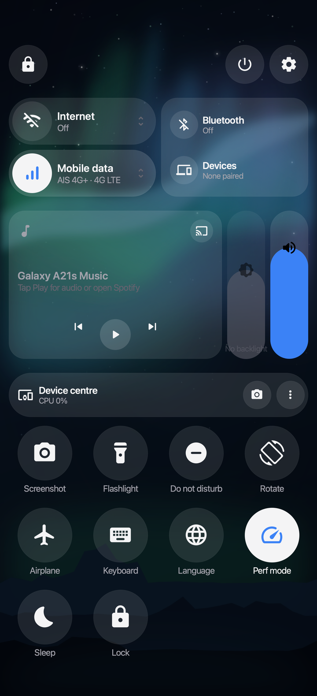
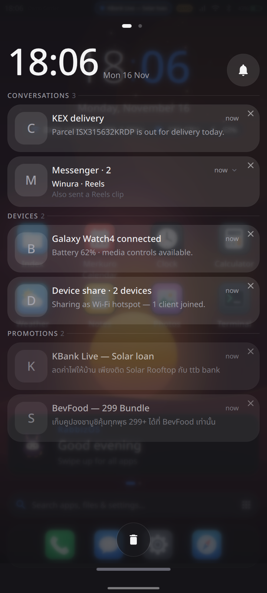
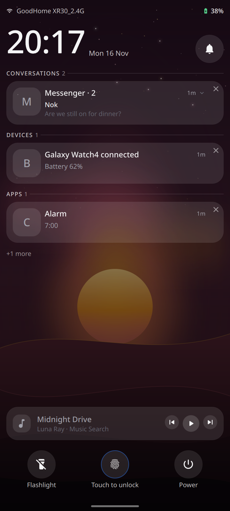
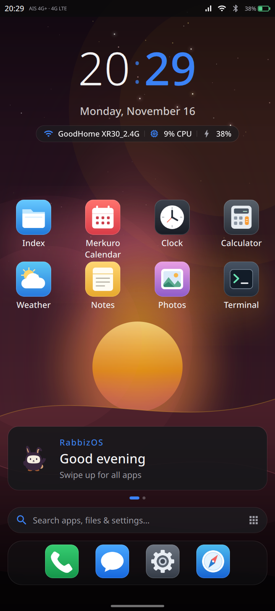

# a21s-phone-shell — session bring-up (labwc + Quickshell on Galaxy A21s)

Android-like launcher DE running **bare-metal on mainline Linux** — replaces
the SteamOS session as the boot UI while leaving `steamos-session.service`
fully intact as a parallel, launchable-anytime unit. Architecture contract:
[shell/README.md](../shell/README.md). Stack: **labwc** (wlroots compositor,
layer-shell + XWayland) + **Quickshell 0.3.2** (shell surfaces) + standalone
**quickshell**-hosted QML apps + **gamescope**-nested Steam.

## How it is wired

```
systemd
 └─ a21s-phone-session.service        (User=gamer, PAMName=login,
    │                                 Conflicts=steamos-session.service,
    │                                 after seatd/dbus/NM/bluetooth)
    └─ /usr/local/bin/a21s-phone-session     (env setup, exec labwc)
         ├─ labwc  ── ~/.config/labwc/rc.xml
         │    • windowRule "*" → Maximize + serverDecoration=no
         │      → every app toplevel is fullscreen, Android single-tasking
         │    • touch: mapToOutput DSI-1 (720x1600 portrait), no naturalScroll
         │    • ~/.config/labwc/environment → session vars incl.
         │      QML_IMPORT_PATH=/usr/share/a21s-shell
         │    • ~/.config/labwc/autostart:
         │       ├─ dbus-update-activation-environment → user services
         │       ├─ quickshell -p /usr/share/a21s-shell/shell.qml   (shell)
         │       └─ squeekboard (OSK, only if installed)
         ├─ apps: /usr/local/bin/a21s-<app>
         │    └─ export QML_IMPORT_PATH + exec quickshell -p .../apps/<app>/<App>.qml
         └─ a21s-steam → gamescope -W 720 -H 1600 -f --steam -- steam ...
              (a normal maximized labwc window, not a separate session)
```

- `/usr/share/a21s-shell/` ← `shell/` (QML modules `A21s.Theme`, `A21s.Services`, `apps/`)
- `.desktop` files in `/usr/share/applications/` feed Quickshell's `DesktopEntries` → home-screen grid
- Seat/device access: `seatd` (`LIBSEAT_BACKEND=seatd`), `gamer` must be in `seat` group — the unit also sets `SupplementaryGroups=seat input video render audio` as a safety net
- `XDG_RUNTIME_DIR` is provided by `pam_systemd` via `PAMName=login`; the unit also sets it explicitly as a fallback

## Packages to install on the device

```sh
pacman -Sy --needed labwc quickshell qt6-declarative qt6-svg qt6-wayland \
  xorg-xwayland gamescope squeekboard noto-fonts ttf-nerd-fonts-symbols \
  upower brightnessctl
```

| Package | Status | Why |
|---|---|---|
| `labwc` | ALARM `extra` | compositor |
| `qt6-declarative` | OK | Qt/QML runtime pulled in by quickshell |
| `qt6-svg`, `qt6-wayland` | OK | icons + wayland QPA plugin |
| `xorg-xwayland` | OK | XWayland for gamescope/Steam |
| `gamescope` | OK in Arch `extra`; **verify aarch64 build** | nested Steam |
| `squeekboard` | OK in Arch; **verify ALARM** | Wayland OSK (input-method-v2, labwc supports it) |
| `noto-fonts` | OK | UI text |
| `ttf-nerd-fonts-symbols` | **UNVERIFIED on ALARM** | shell icon glyphs; fallback: drop any Nerd Font into `/usr/share/fonts/TTF/` |
| `quickshell` | OK — `extra/quickshell 0.3.2-1` aarch64 | verified on archlinuxarm.org |
| `upower` | OK | battery backend for `A21s.Services` |
| `brightnessctl` | OK | brightness keybinds/shade slider |
| `steam` | **not a package** | native ARM64 client already in `/home/gamer/.local/share/Steam` (see `docs/a21s-game-results.md`); `a21s-steam` assumes `steam` is on `PATH` |

## Deploy + switch

```sh
./scripts/deploy_shell.sh                 # → root@172.16.42.1
./scripts/deploy_shell.sh --packages      # just print the pacman line

# on device, one-time:
usermod -aG seat,input,video,render gamer

# switch to phone session (steamos-session stays installed):
systemctl disable steamos-session.service
systemctl enable --now a21s-phone-session.service

# switch back to SteamOS session any time:
systemctl disable a21s-phone-session.service
systemctl enable --now steamos-session.service
```

`Conflicts=steamos-session.service` guarantees only one session owns the
seat at a time — `enable --now`-ing one stops the other.

## Debugging

```sh
journalctl -u a21s-phone-session.service -b -f   # session/compositor log
loginctl                                          # gamer session + seat
swaymsg / labwc --version; ls /usr/share/a21s-shell
```

## Known caveats / open items

- **Steam orientation**: Big Picture was validated at 1600x720 *landscape*
  under Weston (`docs/a21s-game-results.md`). `a21s-steam` uses portrait
  `-W 720 -H 1600` to match the panel's native mode; if gamepadui renders
  badly, rotate the labwc output or flip gamescope to `-W 1600 -H 720`.
- **Modem/telephony**: no modem driver yet (M6) — Dialer/SMS run against
  `A21s.Services.Telephony` demo mode. `gnome-calls` + `chatty` +
  `gnome-contacts` + `callaudiod` + `feedbackd` are installed and ready
  (all ModemManager-based, EDS contacts shared).
- **labwc config keys** (`<touch naturalScroll>`, `skipWindowSwitcher`,
  `OnScreenDisplay` font place) target current labwc (≥0.8); unknown keys
  are warned-and-ignored, not fatal.
- `brightnessctl`/backlight and battery may report unavailable until the
  M5 power drivers land — shell degrades gracefully by contract.

## Shade UI — notifications + quick settings (redesign 2026-11-16)

The pull-down shade was rebuilt to the One UI 7 shape: **grouped cards** instead
of one flat stream, sections that read top-down by importance, and a two-page
pager with dots instead of the old "Notifications | Controls" tab bar.

| Controls | Notifications |
|---|---|
|  |  |

*(Device screenshots of `DSI-1` at 720x1600, 2026-11-16, with notifications
injected through `notify-send` so the grouping is visible. The status bar is a
separate `PanelWindow` and therefore not part of the captured sheet.)*

### Composition

| Page | Top to bottom |
|---|---|
| Notifications | clock (100 px) + date + bell (toggles DND) → **Conversations / Devices / Apps / Promotions** sections → floating clear-all button |
| Controls | lock \| power, settings buttons → connections (2 pill tiles + 1 grouped share card) → media card + **vertical** brightness/volume sliders → device strip (CPU/disk + screenshot/gallery + settings) → 4×3 action grid |

- Pages switch by sideways drag anywhere on the sheet, by tapping a page dot
  (36×28 px hit area, no tab bar), or by pulling down from the left/right half of
  the status bar (`ShellState.shadeMode`, unchanged contract).
- The list/controls areas are `Flickable`s with `interactive: content > height`,
  so in portrait the sheet's own pull-to-close still works; only an overflowing
  sheet (landscape, short heights, long translations) takes the vertical drag.
- Long-press on Wi-Fi / Bluetooth / Devices still opens the connectivity panel
  (`ShellState.connPanelOpen` + `connPanelTab`), unchanged.

### Notification grouping (`Panels/NotificationGroups.js`)

Pure, testable transform (`shell/tests/notificationgroups.test.mjs`, wired into
`scripts/check.sh`) — the QML only renders what it returns. One card per app,
newest first, with a count; a card expands on tap (max 4 rows) and its ×
dismisses the whole group. Category rules, in order:

1. known marketing senders (`shopee`, `kbank`, `ais`, …) → **Promotions**
2. known chat apps (`messenger`, `chatty`, `telegram`, …) → **Conversations**
3. promo wording in the app name or newest text → **Promotions**
4. system/device senders (`bluetooth`, `network`, `device share`, …) → **Devices**
5. everything else → **Apps**

Chat apps win over promo wording on purpose: a friend typing "ส่วนลด" is a
conversation, not an ad. Promotions render dimmed and always last.

### New tokens / widgets

- `Theme`: `shadeCard`, `shadeCardOn`, `shadeWell`, `shadeLine`, `shadeFab`
  (alpha layers over the captured backdrop; light theme flips to black alpha),
  `radiusCard`, `shadeControlButton/TileHeight/IconWell/GroupWell/GridTile/`,
  `shadeMediaHeight`, `shadeSliderWidth`, `fontClock`, `fontMicro`.
- `ShellPrefs.accentInk` — the accent as a glyph colour on an **inverted** "on"
  well (a near-white mono accent would vanish on a white well in dark mode).
- `Widgets`: `QSTile` (large pill, restyled), `QSRowTile` (row inside a grouped
  card), `QSIconTile` (grid circle + label), `QSSliderVertical` (tall pill slider).
  ON state inverts the well to `Theme.text` with an accent glyph.
- `Panels`: `NotificationCard` (replaces `NotificationItem`), `NotificationGroups.js`.

### Verification

Deployed and exercised on the A21s on 2026-11-16 (`/usr/share/a21s-shell`,
`a21s-shell` restarted, clean `quickshell` log). Checked with injected touches
(`a21s-touch`) and screenshots (`grim`): category grouping and per-app collapse,
tap-to-expand, the × and the clear-all button, page swiping in both directions
starting on tiles/cards, dot taps, tile toggles, and vertical slider drags
(brightness 163→209, volume 71→52). `ipc shade state` now also reports
`page` / `pageHeight` / `controlsContent` / `controlsScrolling`.

Two defects only the device could show, both fixed:

- `Shade.qml` lost its `A21s.Widgets` import while the header pills were removed,
  but still uses `BackdropBlur` — the whole shade failed to load until the import
  came back.
- **`ShellPrefs.onAccentColor` has always been black.** QML parses
  `on<Capitalized>` next to a sibling `xxx` property as a *signal handler*, so the
  declaration never receives its initialiser (the same trap `Theme.qml` documents
  for `primaryContent`). Shade glyphs now use the new `ShellPrefs.accentContent`;
  the legacy name is kept for the apps that still bind it (a separate sweep).

Page swiping needed a `DragHandler` in `Shade.qml` with
`grabPermissions: PointerHandler.CanTakeOverFromAnything`: the tiles, cards and
sliders are `MouseArea`s that swallow drags, so a `MouseArea`-only pager could
only work in the 20 px gutters. The handler is x-axis only, so vertical drags
still scroll, move sliders and pull the sheet closed.

### Iterating without the device

`tools/shade-preview/preview.py` renders both pages offscreen with the real QML
(stubbed `Quickshell` types) — see [its README](../tools/shade-preview/README.md);
`qmllint -I shell <file>` (Qt 6.12) catches syntax and missing properties. Neither
excuses checking the phone: both device defects above passed both tools.

## Lock screen — sheet language (2026-11-16)

The lock screen was rebuilt *from the shade*, not from the home screen. The old
overlay copied the home screen's editorial clock and drew itself on a 97 %-opaque
wallpaper: the home clock, icons and dock ghosted through it, the system status
bar and a second lock top bar overlapped, and the fingerprint pad, sleep pill and
corner buttons shared no baseline.



### Composition

| Zone | Content |
|---|---|
| Status line | Wi-Fi/SSID or carrier (left) and battery (right). The system `StatusBar` is under this opaque layer, so the lock draws the only status readout that is visible |
| Header | the notification page's oversized clock + date and the round DND button (`Theme.fontClock`, `Theme.shadeControlButton`) |
| Preview | `NotificationGroups.js` sections (Conversations / Devices / Apps / Promotions) rendered with the same `NotificationCard`s as the shade, capped at 3 cards plus "+N more" |
| Dock | the controls page's media card (`Theme.radiusCard` / `shadeCard`) and three labelled circular actions: Flashlight · Touch to unlock · Power |
| Bottom | the slim home hint (the system `NavBar` is also under this layer) |

Everything shares the sheet's 20 px insets and card language, so the lock screen,
the shade and Settings read as one product.

### Behaviour

- Swipe up anywhere that has no handler (the background `MouseArea`), touch the
  fingerprint pad, or tap the hint — all end in `SystemControl.unlockScreen()`.
- Grouped cards expand/collapse on tap and dismiss with ×. **Action chips are
  hidden on the lock** (`NotificationCard.actionsEnabled: false`): an action can
  launch a window, so it belongs behind the unlock.
- The bell toggles DND, the torch button opens the OLED torch, Power opens the
  session menu.
- The backdrop is opaque by contract. The home screen is drawn underneath this
  layer; the previous translucent "glass" backdrop is what made the lock screen
  look crooked and duplicated.

### Home icons + unlock entrance

- Full-bleed RabbizOS artwork no longer sits on a card tile: the old
  `Theme.card` well + 1 px border drew a dark (white in light theme) frame
  around every icon. The well is now only used for generic/fallback glyphs and
  for the explicit glass style; artwork fills its tile.



- After unlocking, the grid and dock tiles rise, scale and fade in **together**
  as one motion (`AppIcon.entrance`, 520 ms, OutCubic). The tiles are armed
  while the lock screen is up, so the home surface cannot flash its settled
  grid for a frame when the lock layer unmaps.

### Files

- `Panels/LockScreen.qml` (new) — surface + interactions. `PowerMenu.qml` now
  only owns the overlay layer, idle monitors, power menu, torch and sleep
  curtain (1118 → 348 lines).
- `Panels/NotificationCard.qml` — `actionsEnabled` (default `true`).
- `Panels/qmldir` — registers `LockScreen`.
- `Desktop/AppIcon.qml` — bare artwork tiles + the shared unlock entrance.
- `Desktop/HomeScreen.qml` — arm/play the entrance from `ShellState.lockScreenOpen`.
- `Theme.qml` — `onWallpaperFaint` / `onWallpaperLine` for ink and hairlines on
  the always-dark lock wallpaper (`shadeLine` flips to black in light mode).
- This section + `docs/lock-screen-preview.png`.

### Verification

Device 2026-11-16, shell restarted with a clean log. Injected four notifications
through `notify-send` (two Messenger items to exercise per-app grouping, plus
Bluetooth, Clock and a KBank promotion) and a paused track through the
`a21s-spotify` event file. With `a21s-touch` + `grim`: group expand/collapse,
DND toggle, power menu, OLED torch and swipe-up unlock all confirmed; the empty
state was checked with no notifications. An action-bearing notification
(`gdbus ... Notify` with an `open` action) showed its chip in the shade but not
on the lock, as intended. The status line, battery readout and media card are
live services (`Network`, `UPower`, `Media`), not mocks.

## App layer (added 2026-11-15)

- **File managers**: `a21s-files` prefers `index` (index-fm, Maui — true
  touch-first UI) then falls back to **Dolphin phone UI**
  (`PLASMA_PLATFORM=phone:handset`, `QT_QPA_PLATFORMTHEME=kde`,
  `QT_SCALE_FACTOR=1.5`; first-run wipe done once in the wrapper).
  `plasma-integration` + `breeze` + seeded `~gamer/.config/kdeglobals`
  (BreezeDark, `SingleClick`, Noto fonts, `breeze-dark` icons).
- **Raw partition noise hidden**: `99-hide-system-partitions.rules` sets
  `UDISKS_IGNORE=1` on `mmcblk0p*`/`loop0p*` so Android eMMC partitions
  (efs/sec_efs/cpefs/key*/metadata/prism/optics/cache/omr/spu) and the
  pmOS system partitions stop appearing in Dolphin/Index sidebars.
- **Immersive bars**: `ShellState.appOpen` (any non-minimized toplevel
  via ToplevelManager) drives both bars — StatusBar `visible=false` while
  an app is open (exclusionMode `Ignore`, pure overlay; the shade handle,
  power menu and lock screen still reveal it) and NavBar collapses to a
  24 px gesture strip. labwc margin is therefore `top=0 bottom=24`: apps
  draw edge-to-edge, the strip is the only reserved zone. Applies at
  window map time — restart the session (or re-maximize windows) after
  changing margin; `SIGHUP`/`labwc -r` did NOT retile existing maximized
  windows in testing.
- **NavBar auto-hides** (`NavBar.qml`): collapsed to a thin gesture pill;
  tap/swipe-up in the bottom zone reveals back/home/recents, auto-collapse
  after 5 s or after any action. Dolphin-style swipe-reveal is impossible
  for app-internal toolbars — this is the compositor-level equivalent.
- **Calendar**: `merkuro` (`merkuro-calendar`/`merkuro-contact`/
  `merkuro-mail`, needs Akonadi) replaces calindori as the pinned
  calendar; calindori stays installed as fallback.
- **Chrome**: official Google Chrome ARM64 (`google-chrome-stable` .deb
  → `/opt/google/chrome`, wrapper `/usr/local/bin/a21s-browser`) —
  needs `--disable-gpu` (exynos dmabuf), `--force-device-scale-factor=1.5`;
  no Widevine on aarch64 Linux.
- **Connectivity panel** (`ConnectivityPanel.qml`, layer `Overlay`):
  Android-style "Connected devices" sheet — Wi-Fi tab (rescan, network
  list with security/signal/saved marks, password sheet →
  `nmcli device wifi connect`, Disconnect/Forget) and Bluetooth tab
  (toggle, `bluetoothctl` discovery loop, paired+available lists,
  pair→trust→connect/disconnect/remove). Open by **long-pressing the
  Wi-Fi/BT QS tiles** (`QSTile.longPressed`) or
  `ShellState.connPanelOpen/connPanelTab`; closes on X, swipe-down,
  Escape, back or goHome. Services only scan while
  `wifiPanelActive`/`btPanelActive` — no idle polling. PIN-confirm
  pairings may still fail (default agent) — errors surface via toast.
- **OSK**: squeekboard autostarts; `screen-keyboard-enabled=true` +
  `input-sources=[us,th]` set in labwc `autostart` — Thai Kedmanee
  layout + emoji pane built in. Custom layouts in
  `~/.local/share/squeekboard/keyboards/{us,th}.yaml` (Gboard-style
  number row) override the compiled-in ones by name. `a21s-osk-ctl`
  gives system-level control: `toggle` force-shows/hides via
  `sm.puri.OSK0 SetVisible` (covers apps without text-input-v3 —
  terminals, XWayland, games), `lang-next` flips EN⇄TH instantly by
  reordering input-sources + setting `current=0` (squeekboard follows
  sources[0]; its own 🌐 key still opens the prefs popover, which also
  holds emoji). Quick Settings has Keyboard + Language tiles wired to
  it. Dead ends on labwc: maliit, plasma-keyboard, ibus (all
  `input-method-v1`). Better long-term Thai IM: `fcitx5` +
  `fcitx5-libthai` (real sequence-checking IM), or `stevia` (more
  Gboard-like, conflicts squeekboard).
- **runuser env trap**: `runuser -u gamer` inherits the *parent's*
  `XDG_RUNTIME_DIR`/`DBUS_SESSION_BUS_ADDRESS` (e.g. `/run/user/0`) —
  gdbus/gsettings calls then hit "Could not connect: Permission denied".
  `a21s-osk-ctl` repoints both at the runtime dir owned by the current
  uid before touching the session bus.
- **Disk is ~99% full** (22G root, Steam ~7.5G) — installs must be
  batched; `pacman -Scc` between waves. Freed: stale `7.3.4-1-aarch64-ARCH`
  modules (205M), /root boot-img backups (moved to `backups/` on host).
  Wave-2 apps deferred (clapper/papers/loupe/gnome-maps/geary).
- **AppDrawer/Devices picks**: Maui suite (`buho`, `maui-station`,
  `maui-pix`, `vvave` installed; `maui-nota`/`fiery`/`maui-shelf`/
  `maui-clip`/`communicator`/`arca`/`strike`/`maui-agenda` all in ALARM
  extra aarch64), KDE Gear mobile (`kasts`, `arianna`, `audiotube`,
  `tokodon`, `neochat`, `ktrip`, `keysmith`, `alligator`, `plasmatube`,
  `plasma-camera`), GNOME adaptive stack — all verified packaged on the
  device.
