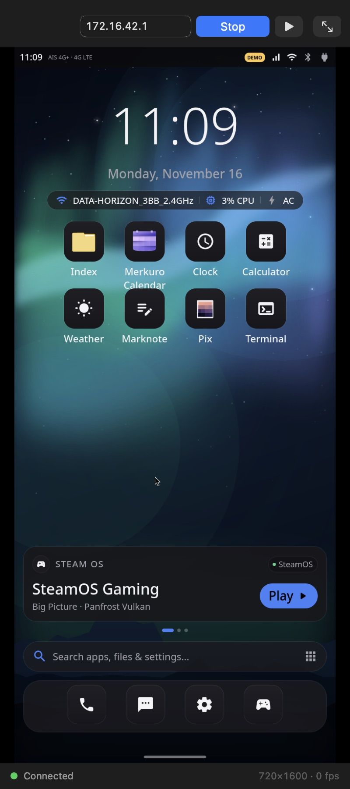

# Rabbiz Mirror — the phone's screen on the Mac

A native macOS app that shows the A21s framebuffer in a window and drives the phone
with the Mac's mouse and keyboard. It talks **RFB 3.8 (VNC)** to `wayvnc` running
inside the phone's `labwc` session — no ADB, no scrcpy, no Android runtime.



## Why VNC and not scrcpy

The A21s runs Native Mainline Linux + Arch Linux ARM64 (`docs/PLAN.md`); there is no
Android, so ADB/scrcpy has nothing to attach to. `labwc` is a wlroots compositor, and
wayvnc is the standard wlroots screen-capture/virtual-input server: `wlr-screencopy`
for pixels, `wlr-virtual-pointer`/`wlr-virtual-keyboard` for input. That is exactly the
pair of protocols this port already has.

## How it works

```text
Rabbiz Mirror.app (Mac)                            A21s (Arch Linux ARM64, labwc)
┌─────────────────────────┐   RFB 3.8 / ZRLE    ┌────────────────────────────────┐
│ RFBClient (thread)       │◀───────────────────│ wayvnc (a21s-wayvnc.service)    │
│  ZRLE → BGRA → CGImage   │   FramebufferUpdate │  wlr-screencopy (DSI-1)         │
│ MirrorView (AppKit)      │───────────────────▶│  wlr-virtual-pointer/keyboard   │
│  absolute pointer + keys │  Pointer/KeyEvent   │                                 │
└───────────┬─────────────┘                     └────────────────────────────────┘
            │ ssh root@172.16.42.1 rabbiz-mirror start
            └────────────────────────────────────▶ systemctl --user start a21s-wayvnc
```

Verified facts on this device:

- `wayvnc 0.10.2` + `neatvnc 1.0.3` + `aml 1.0.0` from Arch Linux ARM `extra`,
  installed **offline** by `scripts/mirror_setup.sh` (the phone had no Wi-Fi when this
  was written; the Mac downloads the `.pkg.tar.xz` files and `scp`s them over USB).
- Servers offered: security type `1` (None), framebuffer `720x1600`, output `DSI-1`.
- Encodings offered: ZRLE, CopyRect, Raw, DesktopSize. The client requests ZRLE first.
- A pointer click sent through the app launched Steam on the phone (the home screen's
  SteamOS card) — end-to-end input proof.

## Install

One-time, from the Mac (device on USB, SSH key auth to `root@172.16.42.1`):

```bash
./scripts/mirror_setup.sh          # USB + localhost only
./scripts/mirror_setup.sh --lan    # also listen on all interfaces (Wi-Fi)
```

What it does:

1. Installs `aml`, `neatvnc`, `wayvnc` with `pacman -U` (downloading on the Mac into
   `tools/rabbiz-mirror/.cache/pkgs/`, gitignored).
2. Writes `~rabbiz/.config/systemd/user/a21s-wayvnc.service`:
   `wayvnc -o DSI-1 -f 30 172.16.42.1 127.0.0.1`, `Restart=always` so it comes back
   whenever `labwc` restarts (the session unit and the user manager outlive it).
3. Writes `/usr/local/bin/rabbiz-mirror` (`start|stop|restart|status|logs|enable`) and
   enables + starts the unit in the running session.

Build the Mac app:

```bash
./scripts/build_mac_app.sh --run   # → "dist/Rabbiz Mirror.app"
```

The app is plain Swift/AppKit + system zlib (`swift-tools-version:5.9`, macOS 13+).
No package dependencies.

The app icon lives in `tools/rabbiz-mirror/Assets/`: `AppIcon.svg` is the editable
vector source (Rabbiz with a paired-screen badge), `AppIcon.png` is the 1024 px export, and `AppIcon.icns` contains
the macOS sizes (16–1024 px). The build script bundles the icon automatically.
Brand rules and the system mascot live in [BRAND.md](BRAND.md).
The public app name is Rabbiz Mirror; the Swift target `RabbizMirror`,
`tools/rabbiz-mirror`, and bundle identifier remain stable so existing build commands
and macOS Local Network permissions continue to apply.

**Local Network permission (macOS 15+).** A GUI app is not exempt from Local Network
privacy the way a Terminal command is. On first connect macOS asks for permission; allow
it, otherwise every connection fails with `No route to host` and — because the app uses
raw BSD sockets — the sheet may never appear. The app therefore fires a small
`NWConnection` probe on first connect to make macOS attribute the traffic and show the
sheet. A *stable* signature is required for the grant to persist: `build_mac_app.sh` signs
with your Apple Development identity when one is installed, and falls back to ad-hoc
(which macOS may silently deny).

## Use

1. Plug the phone in (USB gives `172.16.42.1`).
2. Open **Rabbiz Mirror**. It auto-connects to `172.16.42.1:5900`.
3. If nothing is listening, press **▶** (Start on device) — the app SSHes in and runs
   `rabbiz-mirror start`, which waits until port 5900 is open, then connects.

| Input | Sent as |
|---|---|
| mouse move / drag | absolute `PointerEvent`, button mask (left = 1) |
| click, right click, middle click | mask bits 1 / 4 / 2 |
| scroll wheel / trackpad two-finger scroll | wheel buttons 8/16 (vertical), 32/64 (horizontal) |
| keyboard | X11 keysyms; modifiers (Shift/Ctrl/Alt/Cmd→Super) sent on `flagsChanged` |
| ⌘F | fullscreen |
| ⌘R / ⇧⌘R / ⌘. | connect / start on device / disconnect |

The window can be resized freely; the framebuffer is aspect-fit.

## Security

wayvnc is started **without authentication** (security type `None`) and by default
listens only on `172.16.42.1` (USB) and `127.0.0.1`. Anyone who can reach port 5900 can
see and control the phone — which is the point on a USB cable, and a bad idea on an
untrusted network. Only use `--lan` on a network you control.

## Limitations

- **Pointer, not touch.** Wayland's virtual pointer is a mouse. Swipes/pinches and
  edge gestures need the touchscreen (or `scripts/touch_swipe.py` over SSH).
- **Cursor quirks.** wayvnc does not damage on cursor-only moves, so the captured
  cursor can freeze; the client requests a full repaint every 4 s to heal it. The Mac
  cursor is the responsive one.
- **No clipboard, no audio.** RFB clipboard/audio are not implemented.
- **30 fps cap** (`-f 30`); on a static screen the app shows `idle`.
- **Thai typing** uses the phone's own on-screen keyboard; the Mac sends X11 keysyms,
  so only layouts present on the phone can be produced.
- If `labwc` restarts, `a21s-wayvnc` restarts automatically; the app must reconnect.

## Troubleshooting

```bash
ssh root@172.16.42.1 rabbiz-mirror status   # unit state + listening addresses
ssh root@172.16.42.1 rabbiz-mirror logs     # wayvnc journal
ssh root@172.16.42.1 rabbiz-mirror restart
```

- **Port 5900 already in use** — a manually started `wayvnc` from an earlier probe
  holds it; `mirror_setup.sh` kills it before enabling the unit.
- **`Start` fails with permission denied** — the Mac must have passwordless SSH to
  `root@172.16.42.1` (`BatchMode=yes`).
- **`No route to host` from the app but `--selftest` works** — that is Local Network
  privacy: enable **System Settings → Privacy & Security → Local Network → Rabbiz Mirror**,
  then relaunch. Terminal-launched runs inherit Terminal's exemption, so the headless
  selftest is unaffected.
- **Package filenames 404** — the mirror rotates; update the three pinned filenames in
  `scripts/mirror_setup.sh` (they live in `extra/` for `aarch64`).
- **Wayland socket missing** — the unit retries every 2 s until `labwc` is up; check
  `systemctl --user status a21s-wayvnc` as `rabbiz`.

## Verification

```bash
./scripts/verify_mirror.sh
# selftest: connected 720x1600
# selftest: ok — 20 frames ...
# mirror verified: 720x1600 → /tmp/rabbiz-mirror-verify.png
```

The headless `RabbizMirror --selftest` runs the same RFB client as the app, writes a PNG
and fails if no frame arrives. `RabbizMirror --snapshot out.png` renders the app's own
window (useful in this headless environment, where `screencapture` needs TCC
screen-recording permission).

## Files

| Path | Role |
|---|---|
| `tools/rabbiz-mirror/Sources/RabbizMirror/RFBClient.swift` | RFB 3.8 client, pointer/key messages, full-refresh timer |
| `tools/rabbiz-mirror/Sources/RabbizMirror/ZRLEDecoder.swift` | ZRLE/TRLE tile decoder (palette, RLE, CPIXEL→BGRA) |
| `tools/rabbiz-mirror/Sources/RabbizMirror/Inflater.swift` | persistent zlib stream for ZRLE |
| `tools/rabbiz-mirror/Sources/RabbizMirror/MirrorView.swift` | aspect-fit drawing, mouse/key translation |
| `tools/rabbiz-mirror/Sources/RabbizMirror/MainWindowController.swift` | window, status, Start/Connect |
| `tools/rabbiz-mirror/Sources/RabbizMirror/MirrorSelfTest.swift` | headless `--selftest` |
| `scripts/mirror_setup.sh` | device install + unit + helper |
| `scripts/build_mac_app.sh` | release build + `.app` bundle |
| `scripts/verify_mirror.sh` | end-to-end check |
